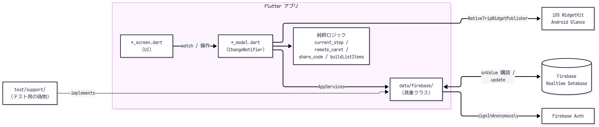
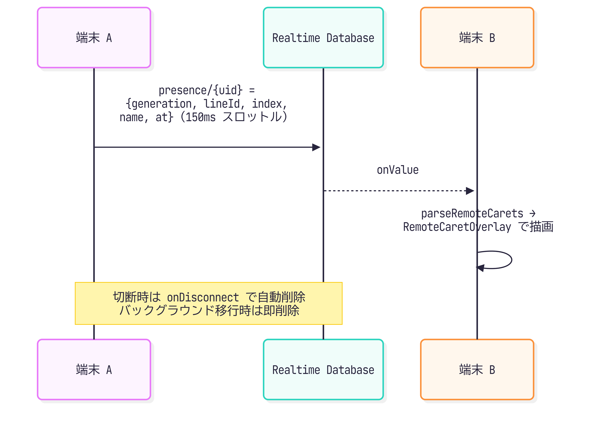
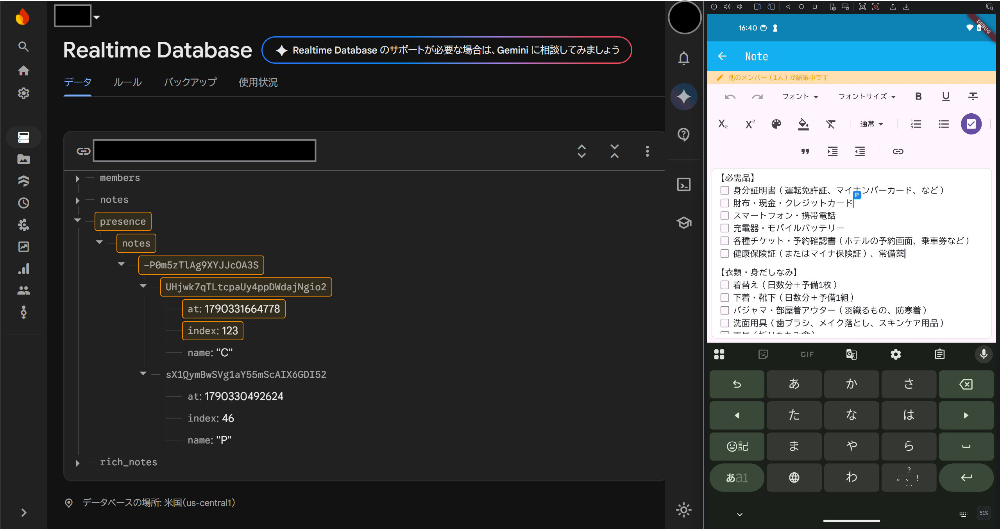
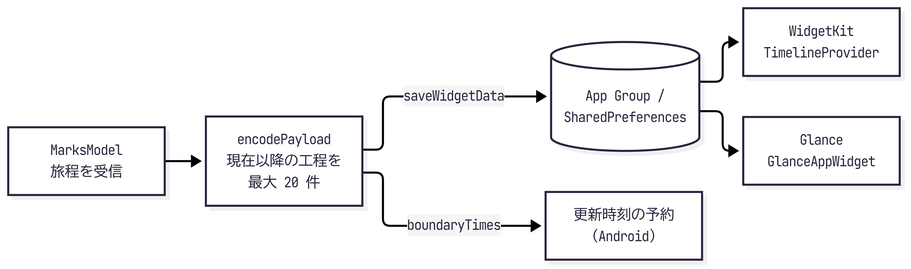

# アーキテクチャと設計

本アプリの構成と、主な設計判断の理由をまとめます。

## この文書の要点

主な設計判断と、その理由です。詳しくは、各項目の最後のリンク先にあります。

- 守りはアプリではなくセキュリティルールに置く：匿名認証では、改造したクライアントも読み書きできるため、アプリの検査は信頼できません。そこで、認可と入力の検証をセキュリティルールに集約しました（[セキュリティルール](#セキュリティルール)）。
- 削除と停止は「閉鎖の記録」で知らせる：メンバーの登録は 1 回の更新で消えるため、関数が動くときには、宛先もタイトルも読めません。そこで、オーナーが同じ更新に閉鎖の記録を書き、宛先はサーバーがメンバーの差分から決めます（[契機と宛先の決め方](#契機と宛先の決め方)）。
- ノートは段落ごとに同期する：全文で保存すると、別の段落の編集まで競合します。そこで、段落に ID を付けて変えた段落だけを書き込み、競合を段落の中に限定しました。同じ段落は後勝ちです（[本文の同期](#本文の同期)）。
- 時刻は絶対時刻で保存する：現地時刻のまま扱うと、「いま・つぎ」の判定が、端末のタイムゾーンや夏時間に左右されます。そこで、エポック秒で保存して絶対時刻で比べ、タイムゾーンは入力と表示だけに使います（[時刻とタイムゾーン](#時刻とタイムゾーン)）。
- 通常の書き込みは、端末への反映で完了とする：SDK の `set` / `update` は、サーバーとの同期が終わるまで完了しないため、待つと画面が止まります。そこで、端末内の `onValue` への反映で完了とし、参加や削除などだけはサーバーの応答を待ちます（[オフラインと書き込みの完了](#オフラインと書き込みの完了)）。
- 「いま・つぎ」はウィジェットの側で判定する：判定結果を渡すと、アプリが起動するまで表示が進みません。そこで、現在以降の工程リストを渡し、ネイティブ側が境界時刻ごとに判定します（[ホーム画面ウィジェット](#ホーム画面ウィジェット)）。

目的別の読み方です。

- 全体像を知りたい：[全体構成](#全体構成) → [データモデル](#データモデル)
- 共同編集の仕組みを知りたい：[共同編集のしおり](#共同編集のしおり) → [共同編集ノート](#共同編集ノート) → [セキュリティルール](#セキュリティルール)
- 品質の作り方を知りたい：[テスト方針](#テスト方針) → [解消した課題](#解消した課題) → [トレードオフと今後の課題](#トレードオフと今後の課題)
図は PNG で掲載し、編集用の `.mmd` を [同じフォルダ](./) に置いています。[図の更新手順](#文書の図) で再生成できます。

- [この文書の要点](#この文書の要点)
- [全体構成](#全体構成)
  - [ディレクトリ](#ディレクトリ)
- [画面と状態管理](#画面と状態管理)
- [オフラインと書き込みの完了](#オフラインと書き込みの完了)
  - [通常の書き込み](#通常の書き込み)
  - [オフラインでも値が届くようにする](#オフラインでも値が届くようにする)
  - [サーバー確認が必要な操作](#サーバー確認が必要な操作)
  - [オフラインで作ったしおりの再接続](#オフラインで作ったしおりの再接続)
  - [検証の範囲](#検証の範囲)
- [認証](#認証)
  - [アカウントの削除](#アカウントの削除)
- [データモデル](#データモデル)
  - [データの取り扱い（プライバシーポリシーの根拠）](#データの取り扱いプライバシーポリシーの根拠)
- [時刻とタイムゾーン](#時刻とタイムゾーン)
- [多言語対応](#多言語対応)
- [共同編集のしおり](#共同編集のしおり)
- [ニックネーム](#ニックネーム)
- [プッシュ通知](#プッシュ通知)
  - [契機と宛先の決め方](#契機と宛先の決め方)
  - [品質](#品質)
  - [文言の多言語化](#文言の多言語化)
  - [アプリ側](#アプリ側)
  - [限界](#限界)
- [テストでの差し替え](#テストでの差し替え)
- [共同編集ノート](#共同編集ノート)
  - [本文の同期](#本文の同期)
  - [表示（色・余白・ツールバー）](#表示色余白ツールバー)
  - [リモートカーソル（プレゼンス）](#リモートカーソルプレゼンス)
- [ホーム画面ウィジェット](#ホーム画面ウィジェット)
- [セキュリティルール](#セキュリティルール)
- [テスト方針](#テスト方針)
- [解消した課題](#解消した課題)
- [トレードオフと今後の課題](#トレードオフと今後の課題)
- [文書の図](#文書の図)

## 全体構成



- バックエンドは Firebase だけです。独自サーバーは持ちません。
  - 同期は Realtime Database の `onValue` 購読で行います。
  - アクセス制御はセキュリティルールで行います。
- オフライン永続化（`setPersistenceEnabled(true)`）を有効にし、電波が弱い場所でも閲覧・編集できます。書き込みの完了の判定とオフラインでの工夫は [オフラインと書き込みの完了](#オフラインと書き込みの完了) にまとめています。
- 認証は Firebase の匿名認証です。
  - アカウント登録は不要で、端末ごとに匿名のユーザーを作ります。
  - しおりへのアクセスは、しおりごとの「公開用しおり ID」とあいことばで共有します（[共同編集のしおり](#共同編集のしおり)参照）。

### ディレクトリ

| パス                                      | 役割                                                   |
| ----------------------------------------- | ------------------------------------------------------ |
| `lib/launch/`                             | 起動画面                                               |
| `lib/leaflets/`                           | しおり一覧（画面、カード、ダイアログ、Model）          |
| `lib/marks/`                              | 旅程タイムライン（画面、項目、ダイアログ、Model）      |
| `lib/notes/`                              | 共同編集ノート、リモートカーソル                       |
| `lib/sharing/`                            | 共同編集の設定・参加、ID とあいことば                  |
| `lib/notifications/`                      | プッシュ通知（FCM、許可とトークン、届いた通知）        |
| `lib/data/`                               | Firebase との境界（`AppServices`）、サンプル           |
| `lib/entity/`                             | DB の値とモデルの変換                                  |
| `lib/helper/`                             | 「いま・つぎ」、タイムゾーン、ウィジェットへの受け渡し |
| `lib/l10n/`                               | 文言（ARB と生成物）、言語の決め方、都市名             |
| `lib/theme/`                              | ライトとダークのテーマ、色                             |
| `lib/components/`                         | 共通 UI                                                |
| `lib/extension/`                          | `List`・`DateTime`・`String` の小さな拡張              |
| `functions/`                              | Cloud Functions（通知、毎日の掃除）とそのテスト        |
| `android/app/src/main/kotlin/.../widget/` | Glance ウィジェット                                    |
| `ios/KoalaWidget/`                        | WidgetKit ウィジェット                                 |

- Firebase の具象クラスは `lib/data/firebase/`、共通の型は `lib/data/data_types.dart` にあります。
- サンプルのしおりは `lib/data/sample_leaflets.dart` が組み立て、地域ごとの旅程を `sample_tours_*.dart`、英語の訳を `sample_texts_en.dart` に分けています。
- テーマは `buildAppTheme` でライトとダークを作り、端末の設定に従います（`ThemeMode.system`）。画面は色を `Theme.of(context)` から取ります。

## 画面と状態管理

色、ボタンとラベルの状態、コンポーネントは、[ビジュアルデザイン](../../doc/design/README.md) にまとめました。

画面遷移は `Launch → Leaflets → Marks → Note` の一方向です。
各機能は Screen（UI）と Model（`ChangeNotifier`）の組で構成しています。

- Provider のスコープは画面単位です。
  - Model は画面ごとの `ChangeNotifierProvider` で渡します。
  - アプリ全体で共有する状態は、接続先（`AppServices`）を持つ `AppSession` だけです。アプリの最上位に置き、起動画面で接続したあと、各画面の Model が `context.services` で取り出します。しおりや旅程などのデータは、グローバルに持ちません。
  - 画面を閉じると状態と購読が一緒に破棄されるため、ライフサイクルを追いやすくなります。
- 購読の管理
  - `onValue.listen` の戻り値を `StreamSubscription` として保持し、`dispose` で `cancel` します。
  - 二重購読はガードで防ぎます。
  - 画面を行き来しても、リスナーが増えたりリークしたりしません。
- テストしやすさ
  - UI や Firebase に依存しない判定ロジックは、トップレベル関数や小さなクラスに切り出しています。
  - 対象は `resolveCurrentStep`、`parseRemoteCarets`、`LatestValueThrottle` などです。
  - Model はそれらを呼び出すだけにしています。

## オフラインと書き込みの完了

オフライン中の書き込みは端末に保持され、再接続時に同期されます（[Enabling Offline Capabilities](https://firebase.google.com/docs/database/flutter/offline-capabilities)）。画面を待たせないことと、結果を誤って伝えないことを両立させるため、操作を 2 種類に分けています。

| 種類               | 主な操作                                       | 完了とみなす時点            |
| ------------------ | ---------------------------------------------- | --------------------------- |
| 通常の書き込み     | しおり・旅程・ノートの保存、共有の有効化、脱退 | 端末内の `onValue` に反映   |
| サーバー確認が必要 | 参加、全員を外す削除・停止、アカウント削除など | サーバーの応答（15 秒まで） |

### 通常の書き込み

- [FirebaseLocalWrites](../../lib/data/firebase/firebase_local_writes.dart) が、端末内の `onValue` への反映を確かめて完了にします。SDK の `set` / `update` は、サーバーとの同期が終わるまで完了しないため、画面の待ち時間には使いません。
- 端末内への反映は、サーバーでの承認とは別です。後から権限などで拒否されたときは、ログに残し、一覧画面の Model を通じて SnackBar でも知らせます。データの取り消しと再配信は SDK の購読に従います。
- 通知トークンは、クライアントに読み取り権限が無く反映を確かめられないため、送信を始めたら、完了をバックグラウンドで見守ります。

### オフラインでも値が届くようにする

- 一覧に載るしおりの旅程・ノートは、`keepSynced(true)` でキャッシュを保ちます。索引から外れたときと一覧の購読をやめたときに解除し、参加権限の同期後に購読を復旧したときは登録し直します。
- 旅程は、並べ替え条件をつけずに全体を購読し、アプリ側で開始日時・キーの順に並べます。キャッシュに無い並べ替えクエリは、オフラインでは `onValue` が届かないことがあるためです（[Querying Data Offline](https://firebase.google.com/docs/database/flutter/offline-capabilities#querying_data_offline)）。
- そのため、ルールの `startDate` のインデックス（`.indexOn`）は、いまのアプリでは使っていません。外すには本番のルールのデプロイが要るため、次にルールを変えるときに合わせて見直します。
- 新規しおりの旅程は、子ごとではなく `marks/{leafletKey}` 全体への `set` で保存します。子だけを書くと、SDK が親の完全性を確かめられず、オフラインで親の `onValue` が届かないためです。これは並べ替えクエリとは別の条件で、`keepSynced(true)` では解決しません。
- 新規しおりの空の旅程とノート、サンプルのノートも通常の書き込みにし、進捗の表示をサーバーの応答やトランザクションで止めません。
- キャッシュに無い内容を、オフラインで新たに取得することはできません。

### サーバー確認が必要な操作

- 対象は、共同編集への参加、参加者全員を外すしおりの削除・共有の停止、既存ノートの条件付き初期化、アカウントの削除です。初回の匿名認証とニックネームの変更も、Firebase Authentication との通信が要ります。
- オフラインなら、書き込む前に失敗を返します。接続後に通信が途切れたときも、各 DB 処理の待機を 15 秒で打ち切ります。
- 既存ノートの条件付き初期化は、トランザクションのままにします。通常の書き込みにすると、他の端末の変更を失うためです。
- 接続は `.info/connected` で確かめます。接続の確立前はまず `false` が届くため、最初の値が `false` のときだけ最大 2 秒 `true` を待ちます。15 秒たっても値が届かないときは、まだ何も送っていないので切断として扱います（[接続確認の回帰テスト](../../test/unit/firebase_connection_test.dart)）。
- 送信後の待機が上限に達したときは、失敗ではなく「結果を確認できませんでした。通信が戻ると反映される場合があります。」と表示します。タイムアウトは送信済みの操作を取り消さないためです。結果が分からない間は、端末のあいことばとホーム画面ウィジェットを消しません。
- 送信前の接続確認や読み取りの時間切れは、失敗として表示します。

### オフラインで作ったしおりの再接続

- 再接続すると、参加権限の書き込みより先にしおりの購読が評価され、一度 `permission-denied` になることがあります。
- 一覧は、拒否されたデータを隠し、進行中の書き込みのサーバー応答を待ってから、本人の参加記録を読み直します。記録が残っていれば購読し直します。
- 再試行は同じ接続で 1 回までとし、次の接続でまた試します。索引から消えたあとや、一覧の購読をやめたあとは復旧しません。

### 検証の範囲

| テスト                                      | 確かめること                       | 確かめないこと               |
| ------------------------------------------- | ---------------------------------- | ---------------------------- |
| firebase_offline_test.dart                  | 全サンプルの到達、保存、遅れた拒否 | 実 SDK の永続化、再接続      |
| integration_test/firebase_offline_test.dart | 実 SDK で、全サンプルの追加と表示  | 再起動後の永続化、実サーバー |

- 単体テストは、端末内のイベントだけを流し、サーバーの応答を返さない偽物を使います（`flutter test` に含まれます）。
- 結合テストは、本番と別の Firebase アプリと、接続できないローカルの URL を使い、実 SDK を最初からオフラインにします。子だけの保存では親の値が届かないことも確かめます。CI では動かさず、端末をつないで手動で実行します。

```sh
flutter test integration_test/firebase_offline_test.dart -d <device-id> --flavor development
```

## 認証

- 匿名認証
  - アカウント登録は求めません。「はじめる」で Firebase の匿名認証にサインインします（`connectToFirebase`）。
  - セッションが残っていれば同じユーザーで続けます。サインアウトの操作は用意していません（匿名ユーザーは、サインアウトすると自分のしおりに二度と戻れないため）。
- 削除済み・失効したアカウント
  - 匿名アカウントは、コンソールでの削除や、30 日の自動クリーンアップで、端末の知らないうちに消えることがあります。そのままでは、Firebase Auth が端末でサインアウトしたあと、一覧が空になり、作成もできず、画面に何も出ません。
  - 削除しても、端末の ID トークンは最大 1 時間ほど有効なままで、Realtime Database はトークンだけを確かめるため、その間の書き込みは通ります。Firebase Auth が気づくのも、トークンの更新（約 1 時間ごと）か `reload()` のときだけです。そこで、次のときに `reload()` で確かめます（`LeafletsModel.checkAccount`、上限 5 秒。通信障害や時間切れでは続けます）。
    - 新しいデータを作る操作の前：しおりの作成、サンプルの追加、共同編集の有効化、参加
    - アプリが前面に戻ったとき（`AppLifecycleListener` の `onResume`）
    - タイトルの変更など、ほかの書き込みは、待たせないよう確かめません。気づくまでの間に書いたデータは、毎日の掃除が消します。
  - 「はじめる」では、接続後に `reload()` でユーザーを確かめます（`LaunchModel.start`、上限 5 秒）。削除・失効が確定したら、端末側の後片付けをしてサインアウトし、起動画面のまま「ログインが無効になりました」と知らせます。もう一度「はじめる」を押すと、新しい匿名ユーザーになります。通信障害や時間切れでは、オフラインでも使えるよう、そのまま続けます。
  - 利用中は、`FirebaseAuthGateway.signedOut`（`authStateChanges()` が null）を `LeafletsModel` が購読します。サインアウトされたら、購読を止めて端末側の後片付けをし、閉じられないダイアログで知らせてから、OK で起動画面へ戻します（旅程やノートを開いていても、すべて閉じます）。自分の「アカウントとデータを削除」によるサインアウトは対象外です。書き込みの前にもサインイン状態を確かめ、黙って失敗しないようにしています。
  - 端末側の後片付けは、通知の購読の停止、あいことばの全消去（`SecurePassphraseStore.deleteAll`）、ウィジェットの消去（`NativeTripWidgetPublisher.clear`）です。一覧は権限を失うと先に空になるため、しおりごとではなく、すべて消します。サーバーのデータは、権限が無いため消さず、毎日の掃除に任せます。
  - 回帰テスト：[起動](../../test/unit/launch_model_test.dart)、[Model](../../test/unit/sharing_test.dart)、[画面](../../test/widget/leaflet_management_test.dart)、[起動画面](../../test/widget/launch_flow_test.dart)。
- ニックネーム
  - メニューから設定でき、Firebase Auth のプロフィール（`displayName`）に保存します。共同編集中、先頭の 1 文字がカーソルのバッジに表示されます。
- 送信の開始
  - Crashlytics の収集と FCM の自動初期化は、Android のマニフェストと iOS の `Info.plist` で止めてあります。「はじめる」を押したあと（`connectToFirebase`）に、`DataCollection.start` が有効にします。
- このアプリについて
  - Flutter 標準の `showAboutDialog` で、`package_info_plus` から取得したバージョンを `1.0.0(12)` の形式で表示します。
  - OSS ライセンスは `LicenseRegistry` から自動で集まります。
  - google_fonts のフォントは実行時にダウンロードするため自動では集まりません。OFL の文面を `assets/licenses/` に同梱し、起動時に登録しています。

### アカウントの削除

メニューの「アカウントとデータを削除」で、利用者が自分で消せます（`LeafletsModel.deleteAccount`）。次の順に処理します。

1. 自分がオーナーのしおりを削除する（参加者に「削除」の通知）
2. 参加しているしおりから抜ける（オーナーに「脱退」の通知）
3. 自分の索引（`userLeaflets/{uid}`）と通知のトークン（`users/{uid}`）を消す
4. FCM のトークンを破棄する
5. Authentication のアカウントを消し、起動画面へ戻る

- アカウントを最後にするのは、途中で失敗しても、同じ操作でやり直せるようにするためです。先に消すと、データを消す権限が無くなります。
- 3 のトークンの削除と 4 は、失敗してもアカウントの削除を止めません。残った `users/{uid}` は、毎日の掃除が消します。
- 始める前に、Authentication の `reload()` でユーザーを確かめます。すでに削除・失効していれば、サーバーのデータは消さず、端末側の購読・あいことば・ウィジェットを解除してサインアウトし、起動画面で「データの削除を確認できなかった」と知らせます（あいことばとウィジェットは、しおりごとではなく、すべて消します）。
- 通信障害や再認証の要求では、ログイン状態を保ったまま失敗を知らせます。匿名ユーザーは再認証できないため、`requires-recent-login` で失敗すると削除できません（実機では未確認）。
- 各待機の上限は 15 秒です（[認証回帰テスト](../../test/unit/firebase_auth_test.dart)、[画面回帰テスト](../../test/widget/leaflet_management_test.dart)）。
- 他のしおりに書いた旅程とノートは、書いた人を記録していないため残ります。

## データモデル

しおりのキー（`{lid}`）は、クライアントが作る 12 文字のランダムな ID（Crockford Base32、60 bit）です。そのまま「公開用しおり ID」として手入力・QR で渡します。

| パス                                          | 内容                                              |
| --------------------------------------------- | ------------------------------------------------- |
| `leaflets/{lid}`                              | しおり                                            |
| `leafletMembers/{lid}/{uid}`                  | 参加の証拠（オーナーは `true`、参加者はハッシュ） |
| `leafletSecrets/{lid}`                        | あいことばのハッシュ（誰も読めない）              |
| `userLeaflets/{uid}/{lid}`                    | 自分のしおりの索引（`true`）                      |
| `users/{uid}/fcmTokens/{tokenKey}`            | 通知の宛先の端末トークン                          |
| `leafletClosures/{lid}`                       | 削除・停止の「閉鎖の記録」                        |
| `notificationLog/…`、`notificationThrottle/…` | 通知の二重送信の防止と連打の抑制                  |
| `marks/{lid}/{markKey}`                       | 旅程                                              |
| `rich_notes/{lid}`                            | ノート（段落ごと）                                |
| `presence/notes/{lid}/{uid}`                  | 編集中のメンバーのカーソル                        |

主な項目と、読み書きできる相手です。

- `leaflets/{lid}`：`title`、表紙（`imageUrl` の絵文字、`coverColor`）、期間（`firstDate` / `lastDate` と `firstTimeZoneId` / `lastTimeZoneId`）、`ownerUid`、`shared`（共同編集が有効か）、`createdAt`。`createdAt` はサーバー時刻で、後から変えられない作成時刻の記録です（いまの掃除は使いません）。
- `leafletSecrets/{lid}`：SHA-256 を 1 万回反復したハッシュ（salt は `lid`）。ルールの内部でだけ参照します。
- `users/{uid}/fcmTokens/{tokenKey}`：`token`、`at`、`platform`。キーはトークンの SHA-256 の先頭 32 文字です。本人だけが書け、サーバーだけが読みます。
- `leafletClosures/{lid}`：`kind`、`title`、`at`。オーナーが書き、サーバーが通知の種類とタイトルを知るために読みます。
- `notificationLog/{eventId}/{tokenKey}`（`status` は `pending`、`sent`、`failed`）と `notificationThrottle/{lid}_{uid}_{kind}` は、サーバーだけが読み書きします（[関数の記録一覧](../functions/README.md#5-データベースの記録の一覧)）。
- `marks/{lid}/{markKey}`：`startDate` / `endDate`、`timeZoneId` / `endTimeZoneId`（開始・終了の現地時刻のタイムゾーン）、`actIcon`（移動手段など 13 種）、`title`、`remark`、`link`。
- `rich_notes/{lid}`：`schemaVersion`、初期化ごとの `generation`、`lines/{lineId}`（段落ごとの Delta、挿入位置、削除記録、保存 ID）。
- `presence/notes/{lid}/{uid}`：`at`、`name`、`generation`、`lineId`、段落内の `index`（UTF-16）。

構造の考え方です。

- 一覧用の非正規化
  - しおりの期間（`firstDate` / `lastDate`）は、旅程の更新時に Model が算出して `leaflets` に書き戻します。一覧画面は旅程を読まずに期間を表示できます。
  - 期間・タイトル・表紙の更新は、対象の項目だけを書きます。古い画面がしおり全体を保存して、他のメンバーの変更を戻すことを防ぐためです。
  - 期間は旅程からの導出値ですが、異なる時点の旅程に基づく期間の更新の順序までは、トランザクションで保証しません。
- フラットな構造
  - `marks` と `rich_notes` は `leaflets` の子ではなく、別のルートに置いています。一覧を購読したときに、旅程やノートの本文まで転送されないようにするためです。
  - 旅程の並べ方は [オフラインでも値が届くようにする](#オフラインでも値が届くようにする) を参照してください。
- 一覧は取得できない
  - `leaflets` 全体は読めず、ID を知っている人だけが `leaflets/{lid}` を読めます。
  - アプリは `userLeaflets/{uid}` の索引を購読し、載っている各しおりを個別に購読します。

### データの取り扱い（プライバシーポリシーの根拠）

取得する情報・外部通信・見える相手・保存期間は、利用者向けの [プライバシーポリシー](../legal/privacy.ja.html) に集約しています。ここでは、その記述を実装と照合するときの入口を示します。

| 確かめること                                                 | 実装・設定                                                           |
| ------------------------------------------------------------ | -------------------------------------------------------------------- |
| 匿名認証、ニックネーム、しおり・旅程・ノート、アカウント削除 | firebase_services.dart、[セキュリティルール](#セキュリティルール)    |
| あいことばのハッシュと端末内の平文                           | [共同編集のしおり](#共同編集のしおり)                                |
| カーソルの内容・送信・削除                                   | [共同編集ノート](#共同編集ノート)                                    |
| 通知の宛先・内容・送信記録                                   | functions/README.md Cloud Functions の記録一覧                       |
| ウィジェットに渡す情報と消去                                 | [ホーム画面ウィジェット](#ホーム画面ウィジェット)                    |
| エラーの送信内容と開始条件                                   | data_collection.dart、 operations/README.md クラッシュレポートの運用 |
| サーバーの削除対象と安全確認                                 | operations/README.md 掃除、operations/README.md 公開終了後の手順     |

## 時刻とタイムゾーン

時刻は絶対時刻（エポック秒）で保存し、タイムゾーンは入力と表示だけに使います。

- 旅程の `timeZoneId` は、開始時刻を現地時刻で入力・表示するタイムゾーンです（例：`Asia/Tokyo`）。
  - 飛行機のように到着地が違う旅程は、任意の `endTimeZoneId` で、終了時刻の現地時刻を別のタイムゾーンにできます。無ければ開始と同じです。
  - 空や未知の ID（旧データ）は、端末のタイムゾーンとして扱います。
- 日付ヘッダは、旅程の現地の日付で区切ります。端末のタイムゾーンを変えても、旅程の現地時刻は変わりません。
- 「いま・つぎ」の判定は絶対時刻で比べるため、タイムゾーンに左右されません。
- 現地の日時は、年月日時分だけを持つ `DateTime` で扱い、`instantOf`（現地 → 絶対）と `wallOf`（絶対 → 現地）で変換します（`lib/helper/time_zones.dart`）。タイムゾーンのデータベースは `timezone` パッケージ（IANA。別名も含む）、端末のタイムゾーンは `flutter_timezone` で取得します。
- 夏時間の境目：存在しない時刻（春の 02:30 など）は直後にずらし、2 回ある時刻（秋の 01:30 など）は先の方を選びます。
- 旅程を追加するときのタイムゾーンの既定値：①一つ前の旅程の終了側のタイムゾーン（「ニューヨーク到着」の後はニューヨーク）、②最初の旅程なら端末のタイムゾーン。ユーザーが選ぶまでは、開始日時を変えるたびに選び直します。
- 端末と違うタイムゾーンの旅程には、都市名（`A → B`）を表示します。
- 端末のタイムゾーンの変更は、アプリへ通知されません。そのため `DeviceZoneWatcher` が、アプリが前面に戻ったときと、前面にある間の 3 秒ごとに読み直し、変わっていれば Model が表示を作り直します（再起動は不要）。バックグラウンドでは読み直しません。
- しおりの期間（`firstDate` / `lastDate`）は、最初の旅程の開始と、最後の旅程の終了（無ければ開始）の現地の日付で表示します。そのため、タイムゾーンも導出値として一緒に書き戻します。
- ホーム画面ウィジェットにも、旅程ごとのタイムゾーンを渡し、現地時刻で表示します。
- 日時の書式（`M/d`、`HH:mm`、`MM/dd EEE`）は、端末の言語に連動しないよう、ロケールを `en_US` に固定しています。

## 多言語対応

日本語（ja-JP）と英語（en-US）の 2 言語です。端末の最優先の言語が日本語なら日本語、それ以外はすべて英語にします（アプリ内の切り替えはありません）。

- 文言は Flutter 標準の `gen_l10n` で扱います。`lib/l10n/app_en.arb`（基準）と `app_ja.arb` から、`AppLocalizations` を生成してコミットしています（`flutter pub get` だけでビルドできるようにするため）。
  - 画面では `context.l10n.xxx` で取り出します（`lib/l10n/l10n.dart`）。件数を含む文は、プレースホルダーと複数形（`plural`）にしています。
  - 言語の決め方は `resolveAppLocale`（`lib/l10n/l10n.dart`）です。端末の言語の一覧のうち、先頭だけを見ます。
- Model（`LeafletsModel`、`MarksModel`、`NoteModel`）は、失敗の文言に画面の言語を使うため、`l10n` を画面から受け取ります。何に失敗したかは `WriteTask`（列挙）で表し、文言は `lib/l10n/write_task.dart` で作ります。
- 日時の表記は、言語に連動させません（`1/2`、`HH:mm`、`MM/dd EEE` のまま。`January 2nd` のようにはしません）。`intl` のロケールを `en_US` に固定しています。
- 都市名は、よく使う 16 都市に日本語名を持たせ（`lib/l10n/city_names.dart`）、それ以外は英語名にします。
- サンプルのしおりは、作るときの言語で作ります。英語の文章は `lib/data/sample_texts_en.dart` の表に置き、テストで、すべてに訳があり、使われていない訳が無いことを確かめます。作った後で言語を変えても、中身は変わりません。
- サンプルのノートは、[sample_note.dart](../../lib/data/sample_note.dart) の段落と書式（見出し、文字色、太字、下線、取り消し線、箇条書き、番号付きリスト、チェックリスト、引用、字下げ、リンク）で書き、訳してから Quill の Delta JSON にします。書式の属性名は Quill の Delta 形式に合わせます（[Delta formats](https://quilljs.com/docs/formats)）。
- ノートの文字色・書式の表示は [表示（色・余白・ツールバー）](#表示色余白ツールバー) にあります。
- ネイティブ：Android は `values/strings.xml`（英語）と `values-ja/strings.xml`、iOS は `InfoPlist.strings`（en／ja）でアプリ名を切り替えます。ウィジェットの文言は、Android は `strings.xml`、iOS は端末の言語を見て切り替えます。
- 検査：`tool/ci/check_l10n.py` が、`lib/` に日本語の文字列が直書きされていないこと（サンプルを除く）と、ARB の en／ja のキーとプレースホルダーが一致することを調べます。CI で、`flutter gen-l10n` をやり直して、生成物が最新であることも確かめます。

## 共同編集のしおり

アカウント登録は求めず、端末ごとに匿名のユーザーを作ります。しおりを共同編集にするまでは、作った本人しか見られません。

1. しおりを作る：自分がオーナーになる（`leaflets`、`leafletMembers`、`userLeaflets` を 1 回の更新で書き、途中状態を残さない）。
2. 「共同編集にする」：あいことば（8 文字以上、自動生成もできる）を決める。ハッシュを `leafletSecrets` に、`shared: true` をしおりに書く。画面に ID、あいことば、QR コード（`koala-portfolio://join?id=…&p=…`）を出し、コピーもできる。
3. フレンドが参加する：QR を読み取る、または ID とあいことばを入力する。ID はハイフンで区切った 4 文字 × 3 の入力欄に入れる。入力された文字は変換せず、使えない文字（小文字、`I` `L` `O` `U` など）は赤字にして「入力内容をお確かめください」と表示する（貼り付けた ID は区画に分けて入れる）。クライアントはハッシュを求めて `leafletMembers/{lid}/{自分の uid}` に書く。ルールが `leafletSecrets/{lid}` と一致することを検証し、一致したときだけ参加できる。
4. 参加者は旅程とノートを編集できる。しおりの削除、あいことばの変更、共同編集の停止はオーナーだけ。参加者は自分で抜けられる。
5. 共同編集を停止する：オーナーが、あいことばと `shared` を消し、オーナー以外のメンバーを、1 回の更新で外す（`leafletMembers` と、そのメンバーの `userLeaflets` の索引）。外れた人は、しおりが一覧から消え、開いていた場合は一覧へ戻る。再び有効にしても、もう一度参加が要る。

- 認可はサーバー側のルールで行います。クライアントのチェックは使い勝手のためだけです。
- あいことばの平文は送りません。オーナーの端末にだけ、QR を再表示できるよう `flutter_secure_storage` で保存します（端末を替えると失われ、再設定になります）。
- ID とあいことばのどちらが違っても、同じメッセージ（`permission-denied`）になります。どちらが当たっているかの手がかりを与えません。
- 割り切り
  - あいことばへの総当たり：8 文字以上、自動生成は 10 文字（約 50 bit）、1 万回のハッシュで抑えますが、ルールだけではレート制限できません。将来は App Check などを併用します。
  - QR にはあいことばが入る：読み取った人は誰でも参加できます。画面に「信頼できる相手にだけ見せる」と表示しています。
  - あいことばを変えても、参加済みのメンバーは残ります。メンバーの個別の削除は行わず、外せるのは、共同編集を停止したときの全員だけです。
  - メンバーの索引（`userLeaflets/{uid}/{lid}`）は、本人の領域ですが、オーナーだけが、しおりの停止や削除のときに、他の人の分を消せます（ルールで許可）。これで、外れた人の一覧から、すぐ消えます。
  - 匿名認証は端末ごと：アプリを入れ直す、端末を替えると別のユーザーになります。参加者は ID とあいことばで再参加できますが、オーナーの権限は戻りません。
- テストでは、本物の Firebase の代わりに、メモリ上の `DemoDatabase`（`test/support/`）を使います。Firebase の各具象クラスを `implements` した偽物で、複数の利用者を作って共有と参加を再現できます（[テストでの差し替え](#テストでの差し替え)参照）。

## ニックネーム

通知に「誰が」を出すため、オーナーもフレンドも、ニックネームを必須にしました。

- 入力欄は、共同編集を有効にする画面（オーナー）と、しおりに参加する画面（フレンド）に出します。ニックネームが規則に合うまで、ボタンは押せません。意図しない名前になるのを避けるためです。
- 既定値は、保存済みのニックネーム、無ければ端末の機種名です（Android は `Build.MODEL`、iOS は `modelName`。`device_info_plus`）。端末に付けた名前（「〇〇の Pixel」など）は、個人の名前を含みうるので使いません。
- 規則（`lib/helper/nickname_policy.dart`）：制御文字を空白にし、連続する空白を 1 つにして、前後の空白を除く。1〜20 文字（見た目の文字数）。サーバーも同じ規則で切り詰めます。
- 保存の順番：ニックネーム（Firebase Authentication の `displayName`）を先に保存してから、あいことばの設定や参加を書きます。サーバーは、その書き込みの直後に動き、`displayName` を読んで通知に入れるためです。
- QR コードを読み取っても、参加はしません。公開用しおり ID とあいことばが入るだけで、ニックネームを確かめてから「参加する」を押すと参加します。

## プッシュ通知

参加・脱退をオーナーへ、削除・共同編集の停止を参加者へ知らせます。ここでは設計の理由とアプリ側の動作を説明し、サーバーの判定表・シーケンス図・再試行は [Cloud Functions の解説](../functions/README.md#2-共通の処理の流れ) に集約しています。

### 契機と宛先の決め方

契機は、`leafletMembers/{lid}` の書き込み 1 つです（`onValueWritten`。書き込み前後の値が得られます。[Realtime Database triggers](https://firebase.google.com/docs/functions/database-events)）。削除と停止は、アプリが、メンバーの登録を 1 回の更新でまとめて消します。そのため、しおりの `shared` の変更を契機にすると、関数が動くときには、宛先のメンバーがもう読めません。また、削除のときは、しおり自体が消えていて、タイトルも読めません。

そこで、削除と停止のときは、オーナーが同じ更新に「閉鎖の記録」（`leafletClosures/{lid}`：種類、タイトル、時刻）を含めます。宛先はメンバーの差分からサーバーが決めるため、オーナーが任意の相手へ送ることはできません。記録の書き込み条件は [セキュリティルール](#セキュリティルール)、鮮度と消去は [関数の記録一覧](../functions/README.md#5-データベースの記録の一覧) を参照してください。

### 品質

- 予約はイベント全体ではなく端末ごとにします。一部の送信が失敗しても、成功済みの端末へ再送しないためです。
- 落ちて残った予約は取り直します。送信直後に落ちた場合の重複を許し、取りこぼしを減らす判断です。FCM 自体の配信保証ではありません。
- 連打の抑制と、OS 上の通知の置き換えは、別のメンバーの通知を消さない単位にします。
- 外から呼べる窓口を増やさず、クライアント由来の名前とタイトルはサーバーで無害化します。

時間の閾値、失敗ごとの処置、予約の状態遷移は、[品質のためのユースケース](../functions/README.md#4-品質のためのユースケース) にあります。

### 文言の多言語化

背面では OS が端末の言語の文言を選び、前面ではアプリが同じ情報から ARB のバナーを出します。キーと引数、各言語の定義場所、整合性の検査は [関数の実行設定](../functions/README.md#6-実行の設定) にまとめています。

### アプリ側

- 許可：共同編集を有効にした直後（オーナー）と、しおりに参加した直後（フレンド）に、通知の許可を 1 回だけ尋ねます。拒否されたら、もう尋ねません（`PushCoordinator`）。
- トークン：許可されているとき、起動後に登録し、更新（`onTokenRefresh`）も追います。トークンが取れない環境（APNs が使えない iOS など）では、何もしません。通知は補助なので、失敗してもアプリの動作には影響しません。
- タップ：参加の通知は、そのしおりを開きます。削除と停止の通知は、一覧へ戻り、「しおりにアクセスできなくなりました」と表示します。アプリが終了していたとき（`getInitialMessage`）にも、背面のとき（`onMessageOpenedApp`）にも対応しています。
- Android：通知のチャンネル「共同編集」（ID は `collab`）を `MainActivity` で作り、小さなアイコンは、白いコアラの輪郭です。

### 限界

- ベストエフォートです。FCM の遅れや、まれな取りこぼしがあります。通知がなくても、しおりの内容は、アプリを開けば最新です。
- iOS のプッシュ通知の受信は未確認です。iOS Simulator でのビルド・動作確認には、プッシュ通知の受信を含めていません。個人のチームで署名が通らなくなるため、`aps-environment` の権限は、プロジェクトに入れていません。有効にする手順は、[Firebase の運用](../operations/README.md#通知の関数cloud-functions) にあります。
- 通知の文言は受信時に決まり、あとから端末の言語を変えても変わりません。
- タイトルとニックネームはロック画面にも出ます。気になる場合は、OS の通知設定で内容を隠してください。閉鎖時のタイトルはオーナーが書いた値で、元のタイトルとの一致までは保証しません。
- 数人規模を前提とした送信の制約は、[関数の実行設定](../functions/README.md#6-実行の設定) を参照してください。

## テストでの差し替え

画面と Model は、`AppServices` が持つ具象クラス（`FirebaseLeafletRepository` など）を直接使います。別のインターフェースは定義していません。

- Dart では、`base` や `final` などの修飾子を付けないクラスは、暗黙的にインターフェースも持つため（[Class modifiers](https://dart.dev/language/class-modifiers)）、テストでは具象クラスを `implements` した偽物に差し替えられます（コンストラクタや内部の状態は引き継がないので、Firebase の初期化は要りません）。
- 偽物は `test/support/` にあります。`DemoDatabase` が、しおり・旅程・ノート・カーソル・あいことばをメモリ上に持ち、利用者ごとの `AppServices` を作ります。
- 1 つのメソッドだけ失敗させたいときは、必要な具象クラスだけを `implements` した小さな偽物を使います。ノートでは [NoteRepositoryProbe](../../test/support/note_fixtures.dart) で保存の遅延・失敗や購読イベントの順序を制御します。
- ノートの初期化で使う、入れ子の Map・List の比較は [deep_equals.dart](../../lib/helper/deep_equals.dart) に置き、Firebase の実装・Model・偽物で共用します。
- 割り切り
  - Model は、`data/firebase/` にある自作の具象クラスの名前を型として使います。Firebase の SDK は Model のコードに直接は出てきませんが、具象クラスのファイルを経由して、コンパイル上は SDK に依存します。
  - Firebase のサーバー側の振る舞いは、ルールのテスト（Firebase Emulator）と、関数のテスト（Realtime Database の Emulator）で確かめます。
  - 具象クラス（`firebase_services.dart`）を、Firebase のサーバーや Emulator につないで動かす自動テストはありません。実 SDK をオフラインで動かす結合テストは [検証の範囲](#検証の範囲) を参照してください。

## 共同編集ノート

### 本文の同期

- エディタは flutter_quill です。改行で区切る段落（自動の折り返しは含まない）に、作ったときに ID を付け、段落ごとの Delta JSON を保存します。ID は、段落の文字を直しても、前に段落が増えたり減ったりしても変わりません（行番号のようにずれない）。見出し・リスト・文字の書式も保持します。
- 段落の順序は、`afterId`（挿入先）、論理時計、段落 ID で決めます。同じ位置への同時挿入も、全端末で同じ順に並びます。配列の番号のずれと、一覧全体の保存を避けるためです。
- 変更は、最後の入力から 300 ms 後にまとめ、連続して入力していても原則 2 秒以内に送ります。変えた段落だけを原子的に書き込みます。画面を離れるときとバックグラウンドに移るときは、待たずに送ります。
- 受信済み・未送信・送信中の版を分け、別の段落の受信や古い保存の完了で、未保存の入力を消しません。受信内容は `ChangeSource.remote` の差分として反映し、再送せず、選択位置を追従させます。他人の変更は自分の Undo に含めません。
- 同じ段落の競合は、保存順の後勝ちです。削除は本文を消して構造だけを残し、遅れて届いた編集による復活を拒否します。同じ段落の同時の分割・結合は完全にはマージせず、新しく作られた別 ID の段落は残します。
- 画面を閉じることが確定したら、退場のアニメーション中も新しい保存を始めず、遅れて終わった保存・初期化を画面へ知らせません。しおりの削除やアクセスの喪失で一覧へ移るときも同じです。確定する前の通信・権限のエラーは隠しません。

上限と保証の範囲です。

- 入力の上限は、見た目の 1,000 文字 × 500 段落です。書記素クラスタで数え、改行は数えません。超える変更は全体を拒否します。
- 同時挿入の受信で上限を超えたときは、内容を保持し、減らす編集を許します。
- この上限はアプリの制御です。DB のルールは、認可、外形、世代、変えられない挿入位置、段落の JSON の長さ（20,000 文字以下）を検証しますが、見た目の文字数と総段落数は検証しません。旧仕様の全文 20 万文字というサーバーの上限は、廃止しました。
- 新しい形式で読めない保存データは、確認ダイアログで利用者が選んだときだけ破棄します。旧形式からの変換はしません。確認中に内容が変わっていれば破棄しません。
- 破棄したら新しい世代を発行し、古い保存とカーソルを拒否・非表示にします。通信や権限のエラーは、形式の問題と区別します。
- OS による強制終了の直前の未送信の入力と、同じ段落の構造の編集の競合は、保証の範囲外です。削除記録の自動の圧縮はしません。
- 回帰テストは [note_flow_test.dart](../../test/widget/note_flow_test.dart) と [note_model_test.dart](../../test/unit/note_model_test.dart) です。偽の接続先で動かすため、実際の Firebase SDK のイベントの順序と、オフラインの永続化は確かめていません。
- 実装は [note_document.dart](../../lib/notes/note_document.dart) と [note_model.dart](../../lib/notes/note_model.dart) です。形式を更新するときの注意は [運用](../operations/README.md#ノート形式の更新) にあります。

### 表示（色・余白・ツールバー）

- 文字色は [note_colors.dart](../../lib/notes/note_colors.dart) の 8 色から選びます。黒と白は、白地か黒地に溶けるため含めません。どの色も、ライトとダークの背景に対してコントラスト比 3 以上です（WCAG の大きな文字の基準。[Contrast (Minimum)](https://www.w3.org/WAI/WCAG21/Understanding/contrast-minimum.html)）。サンプルも同じ 8 色を使います。
- 背景色のボタンは出しません。既定の文字色と組み合わせると、どちらかのテーマで読めなくなるためです。
- 保存済みのノートに、読めない文字色（コントラスト比 2 未満）や背景色があっても、データは変えず、表示だけを既定の文字色・背景なしにします。
- エディタの書式は [note_styles.dart](../../lib/notes/note_styles.dart) にまとめ、Quill の既定（テーマの文字色）を引き継いで、余白とリンクの色だけを変えます。色の無い `TextStyle` を渡すと、Flutter が文字を白で描き、ライトモードで見えなくなるためです。
- リンクは、既定の色（テーマの secondary の黄色）が白地で読めないため、文字色と同じ青にします。
- 段落の余白と行の高さは、次の 3 つの定数で決めます。Quill は段落の種類ごとに設定が分かれているため、すべてに同じ値を設定します。

| 定数                   | 値     | 対象                                         |
| ---------------------- | ------ | -------------------------------------------- |
| `noteParagraphSpacing` | 上下 8 | 普通の段落、見出し 1〜6                      |
| `noteLineSpacing`      | 上下 2 | 箇条書き・チェックリスト・引用の行の間と前後 |
| `noteLineHeight`       | 1.5    | 折り返した行の高さ（Quill の既定は 1.15）    |

- チェック済みと未完了の項目は別のまとまりになるため、まとまりの前後の余白も行の間と同じにし、リストの中で間隔が変わらないようにします。
- 箇条書きの文字スタイルは段落の値を上書きするため、行の高さは両方に設定します。見出しは Quill の既定のままです。
- ツールバーで有効な書式のボタンは、Quill が `IconButton.filled`（塗りの面に白いアイコン）で描きます。アプリの `IconButtonTheme` は面を透明にしているため、そのままでは白地に白いアイコンになります。そこで、有効なボタンには淡い面と濃いアイコン（`AppIconButtonKind.tonal`）を指定します（`noteToolbarIconTheme`）。
- テスト
  - [note_readability_test.dart](../../test/widget/note_readability_test.dart)：全サンプルのノートの描画色が、ライトとダークの背景で読める。
  - [note_spacing_test.dart](../../test/widget/note_spacing_test.dart)：種類の違う段落の間隔と、折り返した行の高さを、描画上の位置で確かめる。
  - [note_toolbar_test.dart](../../test/widget/note_toolbar_test.dart)：有効なボタンのアイコンと面のコントラスト比が 3 以上（WCAG の文字以外の要素の基準。[Non-text Contrast](https://www.w3.org/WAI/WCAG21/Understanding/non-text-contrast.html)）。

### リモートカーソル（プレゼンス）



- 本文とは別のパス
  - プレゼンスは本文とは別のパスに保存します。
  - カーソルが動いても本文は再送信されず、ルールも別々に検証できます。
- `LatestValueThrottle`（150ms）
  - 書き込み回数を抑えつつ、最後の位置は必ず送ります。
  - フォーカスが外れたときは、待たずにすぐ送信します。
- カーソル表示を残さない工夫
  - `.info/connected` を監視し、接続のたびに `onDisconnect().remove()` を登録し直します。`onDisconnect` はサーバー側で実行され、切断が検出されると発火します（[Enabling Offline Capabilities](https://firebase.google.com/docs/database/flutter/offline-capabilities)）。
  - `AppLifecycleListener` で、アプリのバックグラウンド移行・復帰に合わせてプレゼンスを削除・再登録します。
- 表示
  - メンバーごとの色は `uid` の FNV-1a ハッシュで決めます。端末をまたいでも同じ色になります。
  - Dart の `hashCode` は実行ごとに同じ値になる保証がないため使っていません（[Object.hashCode](https://api.dart.dev/stable/dart-core/Object/hashCode.html)）。

同時編集中の Firebase Console（Realtime Database）の画面です。`presence/notes/{leafletKey}` の下に、編集中のメンバーごとのカーソル（`at`、`name`、`index`）が保存されています。



## ホーム画面ウィジェット



- Flutter 側は判定結果ではなく、現在以降の工程リストを JSON で渡します。
  - 「いま・つぎ」の判定は、ネイティブ側が表示のたびに行います。
  - アプリが起動していなくても、時刻の経過に合わせて表示が進みます。
- 更新タイミング
  - 各工程の開始・終了時刻を「境界時刻」として扱います。
  - iOS：境界時刻ごとにタイムラインのエントリを作ります。予定のように変化の時刻が事前に分かる場合は、先のエントリまでまとめて渡すのが Apple の推奨です（[Keeping a widget up to date](https://developer.apple.com/documentation/widgetkit/keeping-a-widget-up-to-date)）。
  - Android：境界時刻に更新を予約します。
  - 定期的なポーリングはしないため、電池の消費を抑えられます。iOS ではウィジェットの更新回数に 1 日あたりの上限（目安 40〜70 回）があるため、その対策にもなります（同上）。
- ペイロードの上限
  - 20 件までに絞り、ウィジェットに渡すデータ量を抑えています。
- データの消去
  - ペイロードには、しおりのキー（`leafletKey`。ネイティブ側は読まない）も入れます。
  - しおりの削除と脱退に成功したとき、ウィジェットがそのしおりを表示していれば、データを消し、Android は更新の予約も取り消します（`NativeTripWidgetPublisher.clearFor`）。別のしおりを表示しているときと、キーの無い古いデータは、消しません。
  - 他の人の操作（オーナーによる削除や停止）でしおりが見えなくなったときは、消しません。
- 時刻の表示
  - 各工程のタイムゾーン（`tz`、終了が別なら `endTz`）も渡し、ネイティブ側は現地時刻で表示します（Android は `ZoneId`、iOS は `TimeZone`）。

## セキュリティルール

[database.rules.json](../../database.rules.json) で管理しています。クライアントは信頼しないことを前提に設計しました。

| 観点         | 要点                                                 |
| ------------ | ---------------------------------------------------- |
| 認可         | メンバーだけが、しおりと旅程・ノートを読み書きできる |
| 参加         | あいことばのハッシュが一致したときだけ               |
| オーナー     | 削除と共有の変更はオーナーだけ                       |
| スキーマ検証 | 必須項目、型、長さ、値の範囲、未定義のキー           |
| 整合性       | 終了は開始より後、親のしおりが必要                   |
| ノート       | 外形、世代、挿入位置、段落の長さ                     |
| プレゼンス   | 自分のノードだけ、未来の時刻は拒否                   |
| 通知         | トークンは本人だけ、閉鎖の記録はオーナーだけ         |

- 認可：`leafletMembers/{lid}/{uid}` がある人だけが、そのしおりと旅程・ノートを読み書きできます。
- 参加：書き込むハッシュが `leafletSecrets/{lid}` と一致するときだけ、自分のメンバーの記録を作れます。`leafletSecrets` は誰も読めません。
- オーナー：しおりの削除、`shared` の変更、あいことばの設定・停止は、オーナー（`ownerUid`）だけです。`ownerUid` は、作成時に自分を指定したときだけ書け、後から変えられません。
- スキーマ検証：例えば `title` は 1〜100 文字、`actIcon` は 0〜12、しおり ID は 12 文字です。未定義のキーは `$other: false` で拒否します。
- 整合性：`endDate >= startDate`、`lastDate >= firstDate` です。親のしおりが無い旅程やノートは作れません。
- ノート：外形、世代、変えられない挿入位置、段落の JSON の長さ（20,000 文字以下）を検証します（[共同編集ノート](#共同編集ノート)）。
- 通知
  - 端末のトークンは、本人だけが書けます（形式と長さを検証）。本人は、アカウントの削除のため、自分の `users/{uid}` を丸ごと消せます（消す以外は書けません）。
  - 閉鎖の記録は、そのしおりのオーナーだけが、書き込み時刻と同じ `at` で書けます。オーナーが他のメンバーを外すときは、同じ更新にこの記録が必須です。
  - トークンと閉鎖の記録は、クライアントから読めません。`notificationLog` などの通知の記録には、クライアントは触れられません。

ルールは Firebase Emulator 上のテスト（[test/rules.test.js](../../test/rules.test.js)）で検証しており、CI でも毎回実行します。テストには `@firebase/rules-unit-testing` を使っています（[Build unit tests](https://firebase.google.com/docs/rules/unit-tests)）。

## テスト方針

主なテストだけを挙げます。

| 対象                       | テスト                                                  | 主な観点                                 |
| -------------------------- | ------------------------------------------------------- | ---------------------------------------- |
| 「いま・つぎ」の判定       | current_step_test.dart                                  | 開始前、開始ちょうど、空き時間、終了後   |
| リモートカーソル           | remote_caret_test.dart                                  | 解析、範囲外の補正、スロットル           |
| ウィジェット向けペイロード | trip_widget_publisher_test.dart                         | 過去の除外、件数の上限、境界時刻         |
| 旅程リストの組み立て       | marks_list_test.dart                                    | 日付ヘッダ、「いま・つぎ」、初期位置     |
| 旅程の追加・編集ダイアログ | mark_dialog_test.dart                                   | キャンセル、保存、削除の確認             |
| 画面サイズ別のレイアウト   | layout_matrix_test.dart                                 | 崩れやすい 6 条件で、はみ出しが無い      |
| 共同編集の画面操作         | sharing_flow_test.dart                                  | 参加、設定の変更・停止                   |
| ノートの画面               | note_flow_test.dart                                     | 保存済みの本文、他のメンバーの反映       |
| しおり一覧の画面操作       | leaflet_management_test.dart                            | 作成、編集、削除、脱退、サンプル         |
| セキュリティルール         | rules.test.js                                           | 認可、参加、オーナー、スキーマ           |
| 共有と参加                 | sharing_test.dart                                       | 参加の成否、あいことばの変更、退出、削除 |
| しおり ID とあいことば     | share_code_test.dart                                    | ID の形式、ハッシュ、QR の URL           |
| ニックネーム               | nickname_policy_test.dart、nickname_flow_test.dart      | 規則、既定値、ボタンの条件、保存の順番   |
| 通知（アプリ側）           | push_coordinator_test.dart、notification_flow_test.dart | 許可は 1 回、トークン、バナー、タップ先  |
| 通知（関数）               | functions/test                                          | 判定、送信内容、二重防止、連打、再試行   |
| 掃除（関数）               | cleanup.test                                            | 消す対象の選別、照会の失敗時の中止       |

- 画面サイズ別のレイアウトの 6 条件は、狭い幅、低い高さ、文字 1.6 倍、長い英語の組み合わせです。主要な画面を順に開きます。
- 共同編集の画面操作では、ID の 3 つの欄への入力・貼り付け・間違いと、停止で外れた参加者が一覧へ戻ることも確かめます。
- ニックネームでは、QR コードで自動参加しないことも確かめます。
- 関数のテストは、Realtime Database の Emulator で動かします。掃除は、参加者が残っていても持ち主がいないしおりを消すこと、Authentication に問い合わせられないときは何も消さないことを確かめます。

- 時刻は引数で注入します。時刻に依存するロジックは `now` を引数で受け取るため、境界の時刻を決定的にテストできます。
- 文言や画面の流れを変えても、テストを直さずに済むようにします。
  - 画面の文字は、テストに直接書かず、ARB の文言（`test/support/localized_app.dart` の `ja`、`en`）か、データの定数（`test/support/demo_data.dart`、`test/support/samples.dart`）から引きます。文言そのものを確かめるテスト（[l10n_test.dart](../../test/unit/l10n_test.dart) など）は除きます。
  - 画面の操作（しおりを開く、メニュー、共同編集の設定、参加画面など）は、[app_flows.dart](../../test/support/app_flows.dart) の関数を使います。画面の流れが変わったときは、ここだけを直します。同じ文字が後ろの画面にもあるときは、`inDialog`、`inCard`、`inDrawer` で探す範囲を絞ります。
  - 色は、どの色の名前（トークン）を使っているかではなく、見え方（文字は 4.5:1、線・枠・リングは 3:1 のコントラスト、押すと変わる、無効のときは薄い）を確かめます（[contrast.dart](../../test/support/contrast.dart)）。色を調整しても、基準を満たしていれば、テストを直さずに済みます。ブランドの 2 色の値は、[koala_colors_test.dart](../../test/unit/koala_colors_test.dart) だけで確かめます。
  - サンプルのテストは、件数や名前を固定せず、守るべき条件（国内が先、地域ごとにまとまる、指定した主要都市を含む、夏時間をまたいでも前後関係が崩れないなど）を確かめます。
- 実行コマンド、push 前のフック、CI の起動条件は [CI/CD の仕組み](../ci_cd/README.md#品質の確認ciyml-ほか) に集約しています。
- テストの見直しの効果（手元の Windows で計測）
  - レイアウトのテストは、画面サイズ 5 種類 × 文字サイズ 2 種類 × 画面 6 つなどの総当たり（108 件）から、崩れる原因で選んだ 6 件にまとめました。`flutter test` 全体は、約 111 秒から約 66 秒になりました。
  - テストに日本語を直接書いた箇所は、153 か所から 0 か所になりました。
  - 自動のテストで見つからなかった崩れ（英語・小型の画面で、備考の吹き出しが行からはみ出す）は、端末ごとのスクリーンショット集（[device-matrix.yml](../ci_cd/README.md#端末ごとの画面の確認device-matrixyml)）を人の目で見て見つけ、回帰テストを足しました。

## 解消した課題

開発中に見つけて解消した課題です。それぞれ、何が問題だったかと、どう解決したかを示します。詳しい説明は、各項目の最後のリンク先にあります。

1. 匿名のクライアントを信頼できない（設計）
   - 問題：匿名認証では誰でもデータベースに書き込めるため、アプリの中での検査は、改造したクライアントには効きません。
   - 解消：認可と入力の検証を、セキュリティルールに集約しました（[セキュリティルール](#セキュリティルール)）。
2. あいことばの平文をサーバーに置きたくない（実装）
   - 問題：あいことばをそのまま保存すると、データベースを見られたときに、あいことばそのものが漏れます。
   - 解消：ハッシュだけで照合し、公開用しおり ID は推測しにくいものにしました（[共同編集のしおり](#共同編集のしおり)）。
3. 持ち主のいないデータが容量を使い続ける（運用）
   - 問題：匿名アカウントが消えても、そのアカウントが作ったしおりはデータベースに残り、容量を使い続けます。
   - 解消：持ち主が Authentication にいないことを確かめたものだけを、自動と手動の掃除で消します（[掃除](../operations/README.md#掃除)）。
4. 通知の重複と、予約が残ることによる取りこぼし（実装）
   - 問題：イベント駆動の関数は、同じイベントで 2 回以上動くことがあり、通知が重複します。また、送信の途中で関数が落ちると、送信の予約だけが残り、通知が届かなくなります。
   - 解消：端末ごとに送信を予約し、残った予約は取り直します。同じ通知の連打も抑えます（[品質](#品質)）。
5. 削除と停止で、通知に必要な情報も消える（設計）
   - 問題：削除と停止は、メンバーの登録を 1 回の更新でまとめて消すため、関数が動くときには、宛先もしおりのタイトルも読めません。
   - 解消：オーナーが同じ更新に「閉鎖の記録」を残し、宛先はサーバーがメンバーの差分から決めます（[契機と宛先の決め方](#契機と宛先の決め方)）。
6. 無効な通知先と、一時的な送信失敗（実装）
   - 問題：アプリを消した端末などのトークンには、通知が届きません。また、送信が一時的に失敗することがあります。
   - 解消：無効なトークンは削除し、一時的な失敗は再試行し、想定外のエラーは警告として残します（[品質のためのユースケース](../functions/README.md#4-品質のためのユースケース)）。
7. 通知の言語と、各実装のキーがずれる（実装）
   - 問題：通知の文言のキーと引数は、サーバー・Android・iOS・アプリの 4 か所にあり、どこか 1 か所だけ直すと、ずれてしまいます。
   - 解消：文言は OS が端末の言語で選ぶようにし、4 か所のキーと引数が一致することを CI で検査します（[文言の多言語化](#文言の多言語化)）。
8. 通知に、個人名を含みうる端末名を使いたくない（仕様）
   - 問題：通知に「誰が」を出すとき、端末に付けた名前を使うと、個人の名前が出ることがあります。
   - 解消：ニックネームを必須にし、既定値は機種名にしました（[ニックネーム](#ニックネーム)）。
9. 端末のタイムゾーンの変更が、アプリに通知されない（実装）
   - 問題：端末のタイムゾーンを変えても、アプリには知らされないため、表示が古いままになります。
   - 解消：アプリが前面に戻ったときと、前面にある間の定期的な読み直しで反映します（[時刻とタイムゾーン](#時刻とタイムゾーン)）。
10. 夏時間で、存在しない時刻と 2 回ある時刻（仕様）
    - 問題：夏時間の境目には、存在しない時刻（春の 02:30 など）と、2 回ある時刻（秋の 01:30 など）があり、入力された時刻をどう解釈するかが決まりません。
    - 解消：存在しない時刻は直後にずらし、2 回ある時刻は先の方を選ぶ、という入力の補正規則を決め、境界をテストで確かめます（[時刻とタイムゾーン](#時刻とタイムゾーン)）。
11. アプリの未起動時にも、ウィジェットの表示を進めたい（設計）
    - 問題：アプリが判定した結果を渡すと、アプリが起動するまで、ウィジェットの「いま・つぎ」の表示が進みません。
    - 解消：現在以降の工程のリストを渡し、ネイティブ側が、予定の境界の時刻に更新します（[ホーム画面ウィジェット](#ホーム画面ウィジェット)）。
12. 切断後に残るカーソルと、壊れたノート（実装）
    - 問題：通信が切れたり、アプリが背面に移ったりしても、相手の画面に古いカーソルが残ります。また、読めない形式で保存されたノートは開けません。
    - 解消：切断と背面への移行でカーソルを消し、読めないノートは、利用者に確認してから破棄します（[リモートカーソル（プレゼンス）](#リモートカーソルプレゼンス)、[本文の同期](#本文の同期)）。
13. 英語・小型の画面・大きい文字で、表示が崩れる（テスト）
    - 問題：英語は日本語より文が長く、小型の画面や大きい文字では、はみ出しやすくなります。自動のテストでは見つからない崩れ（備考の吹き出しが行からはみ出す）もありました。
    - 解消：スクリーンショット集で見つけ、文字幅による配置に直し、回帰テストで防ぎます（[テスト方針](#テスト方針)）。
14. 仕様の変更のたびに、多数のテストを直す（テスト）
    - 問題：テストに画面の文字や色の名前を直接書いていたため、文言や色を調整するたびに、多くのテストを直す必要がありました。
    - 解消：文言と画面の操作を共通化し、色は見え方で検査します。総当たりのテストは、崩れる原因で選んだ条件に絞りました（[テスト方針](#テスト方針)）。
15. 法務文書の変更後、無関係な 4 回の push で同じテストが失敗（構成管理）
    - 問題：法務文書の検査を、文書の変更では動かない CI に置いていたため、文書の変更で壊れた検査に、後の無関係な push で気づくことになりました。
    - 解消：法務文書の検査を、毎回動く CI へ移しました。手元で同じ検査を行う仕組みも用意しました（[品質の確認](../ci_cd/README.md#品質の確認ciyml-ほか)）。
16. 利用者が、アカウントとデータを消せない（仕様）
    - 問題：利用者が、自分のアカウントとデータを消す手段がありませんでした。また、先にアカウントを消すと、データを消す権限が無くなります。
    - 解消：データを消してから最後にアカウントを消す順にし、途中で失敗しても、同じ操作でやり直せるようにしました（[アカウントの削除](#アカウントの削除)）。
17. 削除・失効した匿名アカウントで、画面に何も出ない（実装）
    - 問題：匿名アカウントは、コンソールでの削除や自動クリーンアップで、端末の知らないうちに消えることがあり、そのままでは画面に何も出ません。
    - 解消：起動時と利用中に検知し、端末側を片付けて、知らせてから起動画面へ戻します（[認証](#認証)）。
18. 実機のエラーを追えない。報告の失敗でアプリを止めたくない（運用）
    - 問題：利用者の端末で起きたエラーは、手元で再現できないと原因を追えません。一方で、報告の送信が失敗しても、アプリが止まっては困ります。
    - 解消：Crashlytics へ送ります。送信の失敗ではアプリを止めず、「はじめる」の前は送りません（[クラッシュレポート](../operations/README.md#クラッシュレポートcrashlytics)）。
19. 初回のオフライン時に、フォントを取得できない（実装）
    - 問題：フォントは実行時にダウンロードするため、初めて起動したときにオフラインだと、取得できません。
    - 解消：取得できないときは、端末の標準フォントで表示します。
20. 古いしおりの保存で、他のメンバーの変更が元に戻る（実装）
    - 問題：しおり全体を保存していたため、古い内容を表示している端末の保存が、他のメンバーが直したタイトルなどを元に戻していました。
    - 解消：保存する項目（期間・タイトル・表紙）を分け、最新のタイトルを購読します。双方向の上書きは回帰テストで確かめます（[データモデル](#データモデル)）。
21. ノートの全文の保存で、別の段落の入力まで競合する（設計）
    - 問題：ノートを全文で保存すると、別々の段落を書いていても、後の保存が先の入力を消します。
    - 解消：段落の差分を保存し、送信を少し待ってまとめます。受信済み・未送信・送信中の版を分け、受信で未保存の入力を消しません（[本文の同期](#本文の同期)）。

## トレードオフと今後の課題

各判断の理由と、今後の方向です。

1. ノートの同じ段落の競合は後勝ち、削除は優先
   - 理由：異なる段落の編集を併存させ、競合の影響を段落に限定するため。文字単位のマージと構造の編集の完全な競合解決は実装しない。
   - 今後：文字単位の OT / CRDT、削除記録の圧縮、改造クライアントを含む総量の制限。
2. 抽象クラス（インターフェース）を別に定義しない
   - 理由：修飾子の無い Dart のクラスは、暗黙的にインターフェースも持つ。差し替えたいのはテストだけで、本番の実装は Firebase の 1 つのため、二重管理を避けた。
   - 今後：本番の実装が複数になったら、`abstract interface class` を切り出す（既存のコードは変えずに済む）。
3. 時刻は絶対時刻で保存し、タイムゾーンは表示と入力だけに使う
   - 理由：端末のタイムゾーンや夏時間が変わっても保存した値は変わらず、「いま・つぎ」を絶対時刻で比べられるため。
   - 今後：都市名の日本語名を増やす。
4. 言語は日本語と英語だけ。日時の表記は言語に連動させない
   - 理由：対象の読者が絞れており、表記を言語ごとに変えると、入力と表示の整合の確認が増えるため。
   - 今後：言語の追加は ARB を足すだけ。日時の表記は、必要になったら言語ごとに分ける。
5. 想定外のエラーは Crashlytics に送る
   - 理由：実機の不具合を、手元で再現できなくても追えるようにするため。送るのは機種・OS・版・エラーの内容だけで、個人の情報は付けない。ネイティブのクラッシュは自動、Dart のエラーは `FlutterError.onError` と `PlatformDispatcher.onError` から送る。
   - 今後：iOS の dSYM のアップロード設定（Xcode）、Android の難読化時のシンボルのアップロード。
6. 通知は、データベースの変化を契機にする関数で送る。呼び出し型の関数は作らない
   - 理由：クライアントが送信を頼む方式は、誰でも呼べる窓口になり、App Check も使えない（デバッグ署名）。データベースの変化だけなら窓口が増えない。
   - 今後：種類ごとの通知のオン・オフ、通知の履歴の画面。
7. 削除と停止は、オーナーが書く「閉鎖の記録」で見分ける
   - 理由：宛先のメンバーとしおりが同じ更新で消え、関数が動くときには読めないため。記録はクライアントが書くが、宛先はサーバーが差分から決めるので、他の人には送れない。
   - 今後：メンバーの変更をサーバー側で行う（呼び出し型の関数が要り、窓口と App Check の課題が増える）。
8. 通知はベストエフォート（遅れやまれな取りこぼしを許す）
   - 理由：FCM は配信を保証しない。内容はアプリを開けば最新のため。
   - 今後：重要な通知の再送、未読の一覧。
9. 通知にしおりのタイトルとニックネームを出す
   - 理由：「誰が、どのしおりを」が分かるほうが使いやすいため。ロック画面にも出ることは文書に書いた。
   - 今後：ロック画面では伏せる設定。
10. 匿名認証と公開 API キー
    - 理由：登録なしで試せることを優先した。守りは、ルールとそのテスト、毎日の掃除（持ち主がいなくなったしおりを消す）で補う。
    - 今後：App Check（署名つきのリリースビルドが必要）、あいことばの照合の回数の制限。
11. iOS は Simulator でビルド・動作を確認済み。プッシュ通知の受信と、現行版の実機での動作は未確認
    - 理由：Simulator の確認と、実機向けの署名・配布、通知の受信は、別の検証が必要なため。
    - 今後：実機での動作とプッシュ通知の受信の確認、TestFlight での配信。
12. CD の自動化は Android だけ
    - 理由：iOS には macOS のランナーと証明書の管理が必要なため。
    - 今後：iOS の TestFlight での配信。
13. 夏時間の境目の補正を、画面では知らせない。端末のタイムゾーンの変更の反映に、最大 3 秒かかる
    - 理由：タイムゾーンの変更はアプリに通知されず、3 秒ごとの読み直しが限界のため。飛行中に予定を挿入すると、タイムゾーンの既定値は、その飛行の到着地になる。
    - 今後：境目の案内と、既定値の出し分け。
14. アカウントを削除しても残るデータがある
    - 理由：他のしおりに書いた旅程とノートは、書いた人を記録しない設計のため。端末内のキャッシュは、Realtime Database の Flutter のプラグインに消す API が無いため、アプリを削除するまで残る。Crashlytics（90 日）と Cloud Logging（30 日）の保存期間は、アプリから変えられない。いずれもプライバシーポリシーに書いた。
    - 今後：書いた人の記録と、まとめての削除。
15. 同意の記録と、文書の改定時の再同意を作っていない。法務文書は、法律の専門家の確認を受けていない
    - 理由：ポートフォリオアプリでは対象に含めず、「はじめる」を押すことを同意とみなした。文書は、アプリが実際に扱うデータをコードと設定から確かめて書くことを目的にした。
    - 今後：同意の記録と再同意、専門家の確認。

## 文書の図

図は PNG を参照しています。編集用の Mermaid は、各 PNG と同じフォルダ・同じ名前の `.mmd` に保存しています（例：[全体構成の元データ](system-overview.mmd)）。

長い説明文は、意味の切れ目に `<br>` を入れて改行します。フローチャートの矢印ラベルの背景は、`.mmd` の `themeVariables.edgeLabelBackground` で薄いグレー（`#f5f5f5`）にしています。

図を変えるときは `.mmd` を編集し、ローカルで [Mermaid CLI](https://github.com/mermaid-js/mermaid-cli) を使って PNG を作り直し、両方をコミットします。Node.js 22.13 以上と Chrome または Edge、図の `.mmd` が指定するフォント（UDEV Gothic や BIZ UDPGothic）が必要です。CLI の版を固定し、横長の図でも文字を読み取れるよう出力サイズを指定して、白い背景・2 倍の解像度で生成します。リポジトリのルートで実行します。

```powershell
npx -y @mermaid-js/mermaid-cli@12.0.0 -i doc\architecture\system-overview.mmd -o doc\architecture\system-overview.png --size 2400 -s 2 -b white
```

ほかの図も、入力・出力を同名の `.mmd` と `.png` に置き換えて実行します。ブラウザを指定する場合は、環境変数 `PUPPETEER_EXECUTABLE_PATH` に Chrome または Edge の実行ファイルの絶対パスを設定します。図の内容は外部の変換サービスへ送信しません。
