# Cloud Functions の解説

通知と掃除の全体像、通知の判定・送信・再試行を、ユースケースごとの図で解説します。設計の理由とアプリ側の動作は [アーキテクチャと設計](../architecture/README.md#プッシュ通知)、環境設定・デプロイ・掃除の手順は [Firebase の運用](../operations/README.md) に分けています。

図は PNG で掲載し、編集用の `.mmd` を [同じフォルダ](./) に置いています。[図の更新手順](../architecture/README.md#文書の図) で再生成できます。

- [1. 全体像](#1-全体像)
- [2. 共通の処理の流れ](#2-共通の処理の流れ)
  - [2.1 通知の判定](#21-通知の判定)
  - [2.2 共通シーケンス](#22-共通シーケンス)
- [3. ユースケース別のシーケンス](#3-ユースケース別のシーケンス)
  - [3.1 準備：端末のトークンの登録](#31-準備端末のトークンの登録)
  - [3.2 フレンドが参加する](#32-フレンドが参加する)
  - [3.3 フレンドが自分で抜ける（脱退）](#33-フレンドが自分で抜ける脱退)
  - [3.4 オーナーが共同編集を停止する](#34-オーナーが共同編集を停止する)
  - [3.5 オーナーがしおりを削除する](#35-オーナーがしおりを削除する)
  - [3.6 しおりを作る（通知しない）](#36-しおりを作る通知しない)
- [4. 品質のためのユースケース](#4-品質のためのユースケース)
  - [4.1 同じイベントが 2 回届く](#41-同じイベントが-2-回届く)
  - [4.2 一部の端末だけ一時的に失敗する](#42-一部の端末だけ一時的に失敗する)
  - [4.3 無効なトークンを片付ける](#43-無効なトークンを片付ける)
  - [4.4 参加と脱退の連打](#44-参加と脱退の連打)
  - [4.5 古い閉鎖の記録と、古いイベント](#45-古い閉鎖の記録と古いイベント)
  - [4.6 関数が途中で落ちる](#46-関数が途中で落ちる)
- [5. データベースの記録の一覧](#5-データベースの記録の一覧)
- [6. 実行の設定](#6-実行の設定)
- [7. テストと読む順番](#7-テストと読む順番)

## 1. 全体像

通知の関数は 1 つ（`onMembersChange`）です。データベースの `leafletMembers/{leafletId}` が書き換えられるたびに動きます。外から直接呼べる入り口（HTTP など）はありません（[Realtime Database triggers](https://firebase.google.com/docs/functions/database-events)）。

同じ `functions/` に、もう 1 つ、毎日 4:00（日本時間）に Cloud Scheduler が動かす掃除の関数（`dailyCleanup`）があります。下の図は通知と掃除の両方を示します。掃除の詳細は [Firebase の運用](../operations/README.md#掃除) にまとめています（消すもの、安全のための作り、確認の方法）。掃除の関数も、Cloud Scheduler のジョブだけが呼べます（[Schedule functions](https://firebase.google.com/docs/functions/schedule-functions)）。

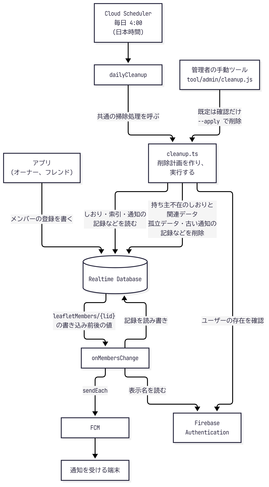

掃除は、Authentication でユーザーの存在を確認してから削除計画を作ります。確認に失敗したら何も削除しません。メンバーの記録の削除も `onMembersChange` を動かすため、持ち主がいなくなったしおりを削除するときは、その持ち主の端末のトークンを先に消します（[cleanup.ts](../../functions/src/cleanup.ts)）。

| ファイル    | 役割                                                                                 |
| ----------- | ------------------------------------------------------------------------------------ |
| index.ts    | 関数の入り口。本物の依存を渡す                                                       |
| handler.ts  | 処理の本体。判定の呼び出し、連打の抑制、二重送信の防止、送信、トークンの掃除、再試行 |
| decide.ts   | 純粋関数。メンバーの前後の差分と閉鎖の記録から、通知の種類と宛先を決める             |
| payload.ts  | FCM のメッセージを組み立てる。文言のキー、引数、Android の `tag`                     |
| nickname.ts | ニックネームを通知に入れられる形にする（20 文字、制御文字の除去）                    |
| cleanup.ts  | 掃除の計画と実行（通知とは別）                                                       |

- `index.ts` は、イベントを受け取り、本物の依存（データベース、Authentication、FCM）を渡します。
- `cleanup.ts` は、持ち主がいなくなったしおりなどを消す計画を作り、実行します。毎日の関数と、手動のツールが同じ処理を使います。

`handler.ts` は、外の世界（データベース、Authentication、FCM、時計）を `Deps` として受け取ります。テストでは、データベースの Emulator だけを本物にし、残りを差し替えます。

## 2. 共通の処理の流れ

どのユースケースも、同じ流れ（`handleMembersChange`）を通ります。結果は、`outcome` としてログに残ります。

### 2.1 通知の判定

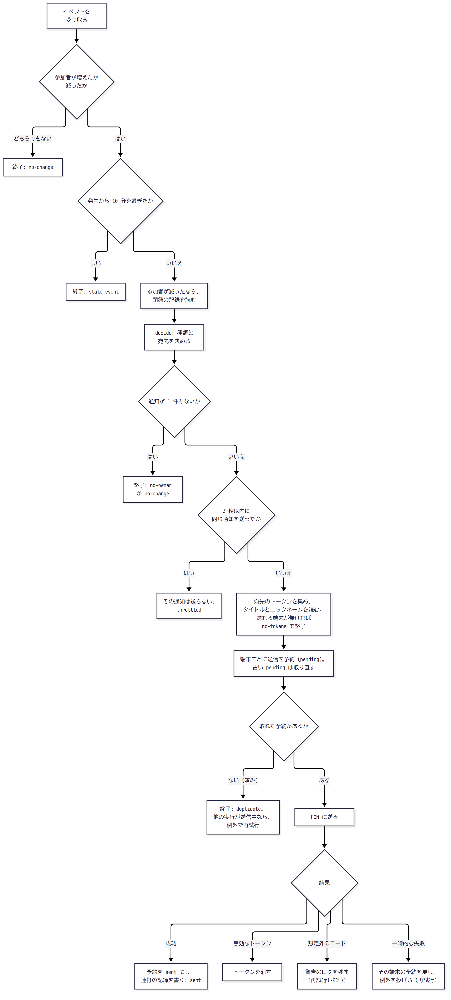

通知の種類と宛先は、[decide.ts](../../functions/src/decide.ts) が次のように決めます。

| 前後の差分                   | 閉鎖の記録                | 通知 | 宛先                               |
| ---------------------------- | ------------------------- | ---- | ---------------------------------- |
| 参加者（値が文字列）が増えた | 見ない                    | 参加 | オーナー（値が `true` のメンバー） |
| 参加者が消えた               | `deleted`（5 分以内）     | 削除 | 消えた参加者                       |
| 参加者が消えた               | `stopped`（5 分以内）     | 停止 | 消えた参加者                       |
| 参加者が消えた               | なし、または 5 分より古い | 脱退 | オーナー                           |

- `leafletMembers/{lid}/{uid}` の値は、オーナーが `true`、参加者があいことばのハッシュ（文字列）です。オーナーは、値が `true` かどうかで見分けます。しおりが消えた後でも、メンバーの記録だけで決まります。
- 「閉鎖の記録」（`leafletClosures/{lid}`：種類、タイトル、時刻）は、削除と停止のときに、オーナーが同じ更新で書きます。参加者が消える理由が「自分で抜けた」のか「オーナーが閉じた」のかを、関数が見分けるためです。削除では、しおり自体も同じ更新で消えるため、タイトルを知る手段にもなります。
- 操作したオーナーは参加者ではないので、削除と停止の宛先に入りません。

### 2.2 共通シーケンス

`onMembersChange` が発火した後の読み書き・送信は、下の図に集約しています。種類と宛先は [2.1 の表](#21-通知の判定) で切り替わり、各ユースケースの図では「参照: 2.2 共通シーケンス」と記載します。

実線の矢印は Request（操作・読み書きの要求）、破線の矢印は Response（取得値・完了結果）です。先端が開いた矢印は、一方向の非同期通知を表します。連続するデータベース処理は、一部をまとめています。

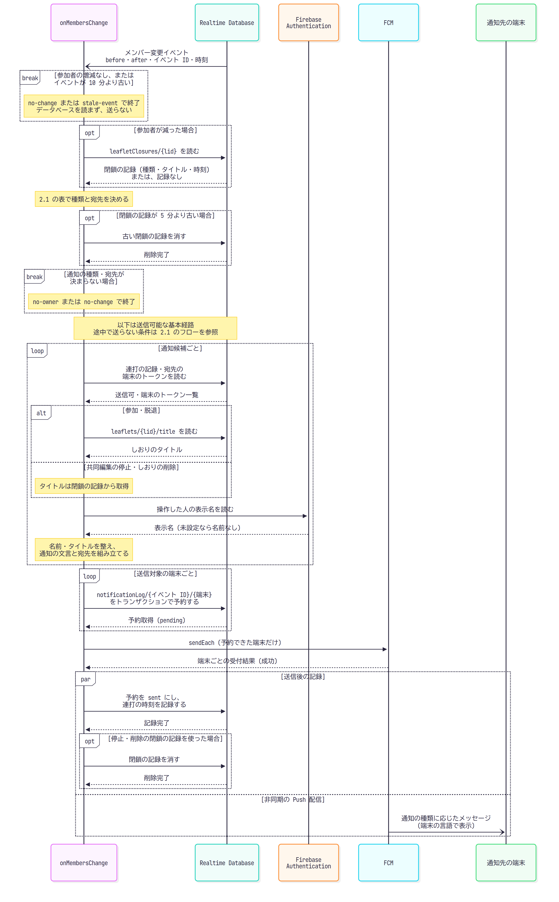

図の送信部分は、連打の制限にかからず、有効な宛先と送信予約があり、FCM の受付が成功する経路です。途中で送らずに終わる条件は [2.1 のフロー](#21-通知の判定)、二重送信や送信失敗などの扱いは [4. 品質のためのユースケース](#4-品質のためのユースケース) で示します。FCM の受付結果は端末への到着確認ではなく、Push の配信と送信後の記録の前後関係も保証されません。

## 3. ユースケース別のシーケンス

各図は、開始契機となるユーザー操作から `onMembersChange` の発火までを示し、以降は [共通シーケンス](#22-共通シーケンス) を参照します。端末のトークン登録（3.1）は、通知を受ける準備なので別に示します。

アプリは Functions の処理や Push の到着を待ちません。データベースの完了応答と、変更イベント・購読更新の前後関係も保証されません。また、作成・脱退・削除では、確認画面を閉じても保存完了とは限らないため、画面の応答と保存の応答を分けています（[leaflets_dialogs.dart](../../lib/leaflets/leaflets_dialogs.dart)、[firebase_services.dart](../../lib/data/firebase/firebase_services.dart)）。

### 3.1 準備：端末のトークンの登録

通知を受ける端末は、先に、自分の FCM トークンをデータベースに登録します。関数は、これを読んで宛先の端末を知ります。

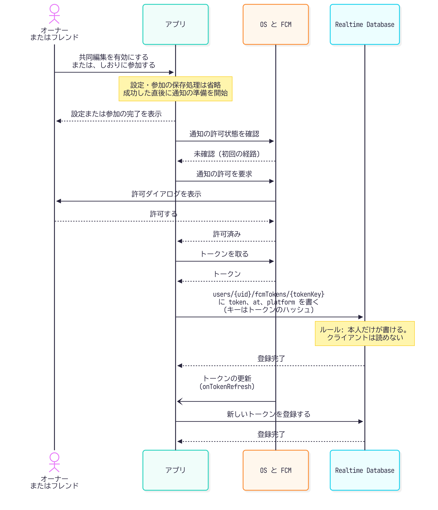

- 許可を尋ねるのは、オーナーは共同編集を有効にした直後、フレンドは参加した直後です（[push_coordinator.dart](../../lib/notifications/push_coordinator.dart)）。拒否されたら、もう尋ねません。すでに許可されている端末は、アプリの起動後に、尋ねずに登録します。
- 同じ端末が登録を繰り返しても、キーが同じなので、時刻が更新されるだけです。
- キーはトークンの SHA-256 の先頭 32 文字です。トークンの形式が保証された仕様ではなく、データベースのキーに使えない文字（`.` `#` `$` `[` `]` `/`）を含みうるためです。以前の形式（キーがトークンそのもの）は、アプリが登録のときに消し、サーバーは、移行の間、両方を読みます。

### 3.2 フレンドが参加する

オーナーに「「北海道」にアキが参加しました」と届きます。通知をタップすると、そのしおりを開きます。

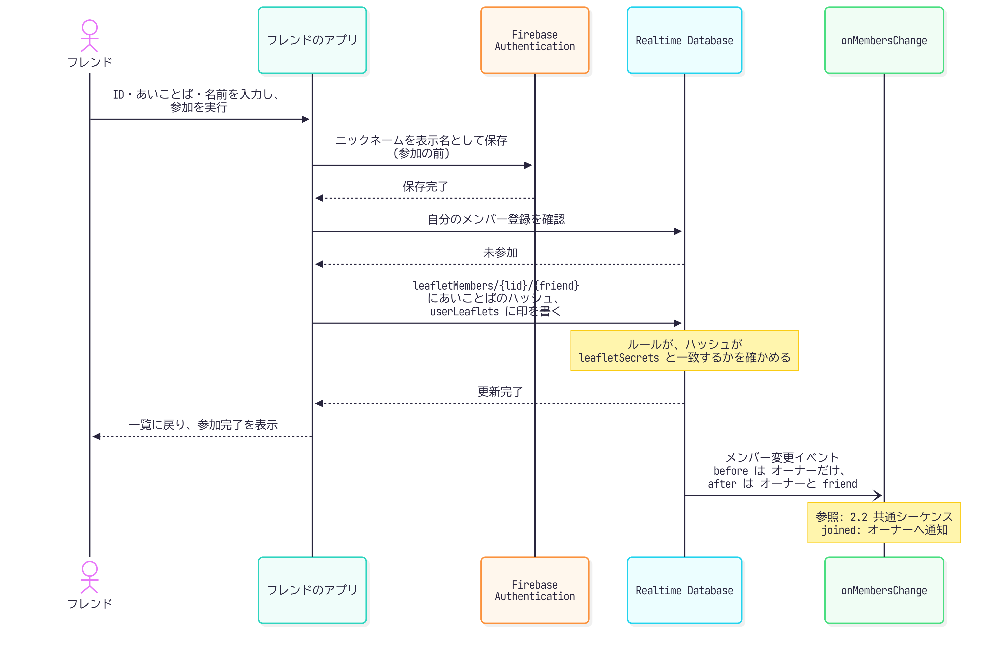

[発火後の共通シーケンスへ](#22-共通シーケンス)

- ニックネームを先に保存するのは、関数が、通知を作るときに、Authentication から表示名を読むためです（[leaflets_model.dart](../../lib/leaflets/leaflets_model.dart)）。
- しおりのタイトルが読めないとき（しおりがすでに無い）は、参加の通知も送りません。「「」に〜」のような文言を避けるためです。
- ニックネームが空のときは、名前なしの文言（「「北海道」にフレンドが参加しました」）になります。名前が読めなくても、通知は止まりません。
- Android の `tag` は `{lid}:joined:{friend}` です。同じ `tag` の通知は置き換えられるため、続けて 2 人が参加しても、1 人目の通知が消えないように、メンバーを含めています。

### 3.3 フレンドが自分で抜ける（脱退）

オーナーに「「北海道」からアキが脱退しました」と届きます。閉鎖の記録がないことが、「自分で抜けた」という判断の根拠です。

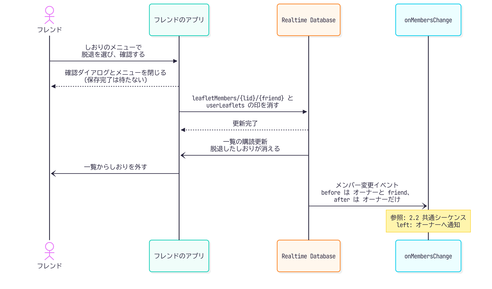

[発火後の共通シーケンスへ](#22-共通シーケンス)

- 脱退した人の表示名は、Authentication に残っているので、名前を付けられます。
- 関数が動くときに、しおりがすでに無い（タイトルが読めない）なら、脱退の通知は送りません。しおりの削除と、ほぼ同時に起きた脱退だと考えられるためです。

### 3.4 オーナーが共同編集を停止する

参加者全員に「アキが「北海道」の共同編集を停止しました」と届きます。見出しは「しおりにアクセスできなくなりました」です。通知をタップすると、一覧に戻り、同じ文言を表示します。

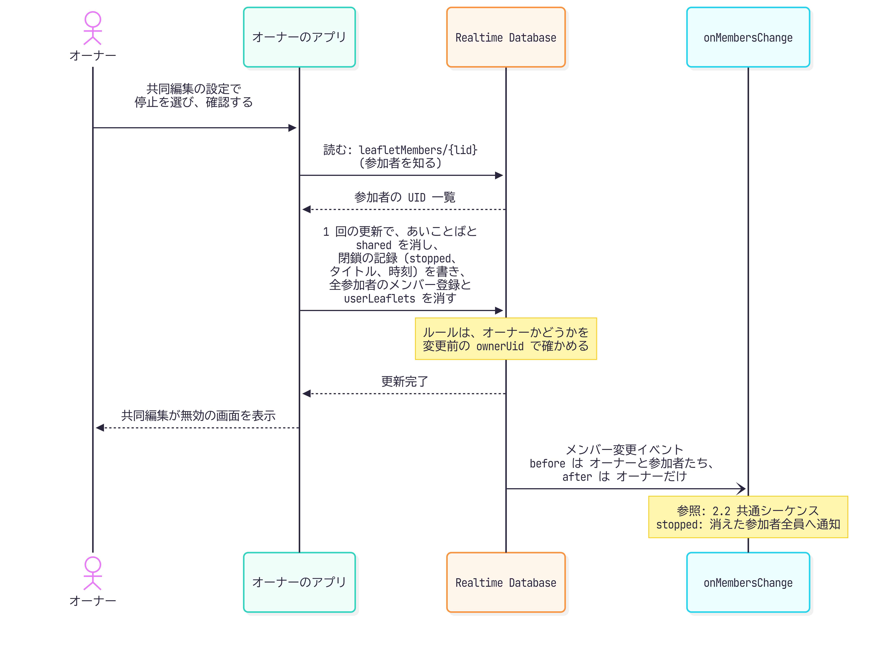

[発火後の共通シーケンスへ](#22-共通シーケンス)

- ルールは、オーナーが他のメンバーを消すとき、同じ更新に、閉鎖の記録（`at` は書き込み時刻と同じ値）があることを求めます。記録なしの追い出しを許すと、関数が「自分で抜けた」と判断し、オーナー自身に「脱退」の通知が飛んでしまうためです。
- 参加者のメンバー登録を、オーナーが同じ更新で消すのは、参加者の画面から、しおりを確実に外すためです。関数が動くときには、参加者の登録がすでに消えているので、関数は、消えた参加者を、書き込み前の値（`before`）から知ります。
- 宛先が複数の場合でも、通知の `tag` は `{lid}:stopped` です。同じしおりへの続けての通知は、1 件にまとまります。
- 閉鎖の記録は、使い終わったら関数が消します。クライアントは、書くだけで、読めません。

### 3.5 オーナーがしおりを削除する

参加者全員に「アキが「北海道」を削除しました」と届きます。停止と同じ流れですが、しおり自体も消えるため、タイトルは、閉鎖の記録から知ります。

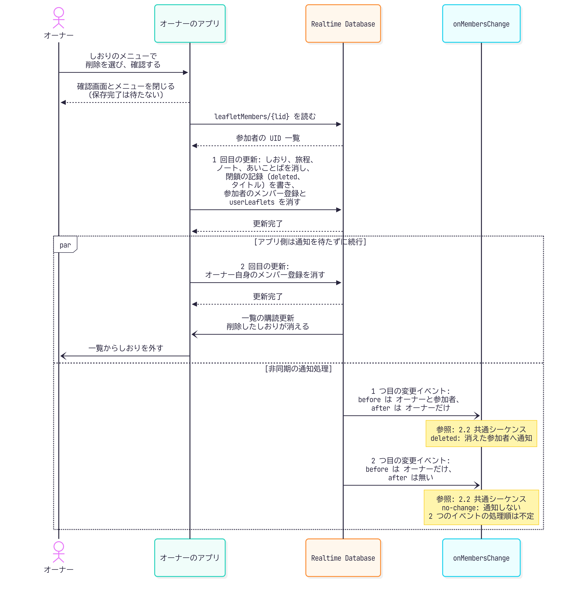

[発火後の共通シーケンスへ](#22-共通シーケンス)

- オーナー自身のメンバー登録は、しおりが消えてから、別の更新で消します（ルールが、しおりが残ったまま、オーナーの記録だけが消える状態を防ぐため。[firebase_services.dart](../../lib/data/firebase/firebase_services.dart)）。この 2 つ目のイベントは、参加者がいないため、何も送りません。
- 削除と停止の両方が、同じ契機（メンバーの書き込み）で動き、閉鎖の記録の `kind` だけで見分けられます。しおりの `shared` の変更を契機にしないのは、そのとき、宛先のメンバーが同じ更新で消えていて、読めないためです。

### 3.6 しおりを作る（通知しない）

しおりを作ると、`leafletMembers/{lid}/{owner}` が `true` で書かれ、関数が動きます。参加者が増えも減りもしないので、すぐに `no-change` で終わります。

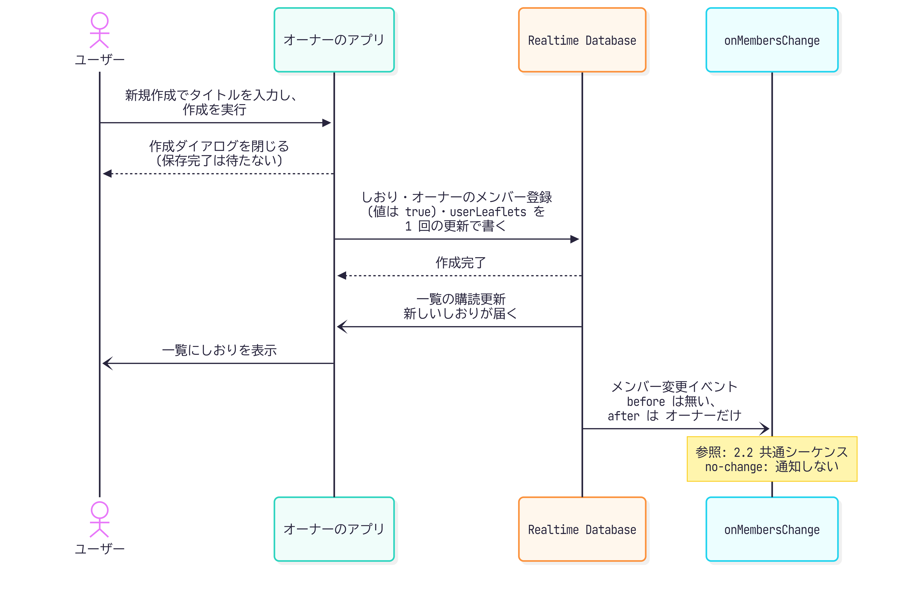

[発火後の共通シーケンスへ](#22-共通シーケンス)

## 4. 品質のためのユースケース

通知は、重複しても、抜けても、困ります。次の図は、[共通シーケンス](#22-共通シーケンス) のうち、重複・失敗・再試行に関係する部分だけを取り出しています。

### 4.1 同じイベントが 2 回届く

イベント駆動の関数は、同じイベントで 2 回以上動くことがあります（[Retry asynchronous functions](https://firebase.google.com/docs/functions/retries)）。二重に届かないように、（イベント ID、端末）ごとに、送信を予約します。

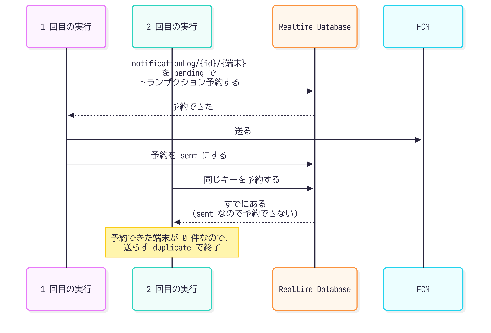

- 予約のキーは、端末のトークンの sha256 の先頭 32 文字です。トークン自体を記録に残さないためです。
- 予約の状態は、`pending`（送信中）、`sent`（送った）、`failed`（再試行しても直らない失敗。送らない）です。`sent` と `failed`、および以前の形式の記録（`status` がないもの）は、済みとして扱います。
- 予約は、データベースのトランザクションで行うため、2 つの実行が同時に動いても、片方だけが予約できます。

### 4.2 一部の端末だけ一時的に失敗する

宛先が複数のとき、一部の端末だけ失敗することがあります。イベント単位の記録だと、再試行で、成功した端末にも、もう一度送ってしまいます。端末ごとの予約にしているので、再試行では、失敗した端末にだけ送ります。

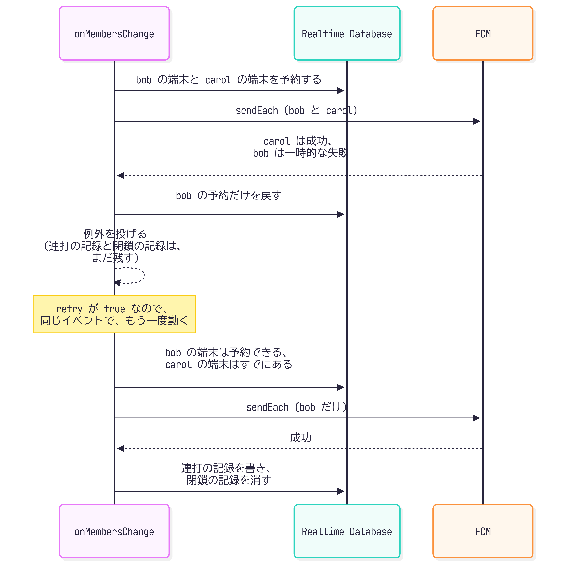

- 第 2 世代のイベント駆動の関数は、既定では、失敗しても再試行されません。そのため、`retry: true` を明示しています（[Retry asynchronous functions](https://firebase.google.com/docs/functions/retries)）。
- 再試行が続きすぎないよう、発生から 10 分を過ぎたイベントは、通知として遅すぎるので捨てます（`stale-event`）。
- 一時的な失敗とみなすのは、`internal-error`、`server-unavailable`、`unknown-error` と、送信の上限に当たったときのコード（`quota-exceeded`、`message-rate-exceeded` など）です。
- 連打の記録は、すべての送信が成功してから書きます。先に書くと、再試行が、連打として抑えられてしまうためです。

### 4.3 無効なトークンを片付ける

アプリを消した端末などのトークンは、送信で「登録されていない」と返ります。関数が、そのトークンを消します。

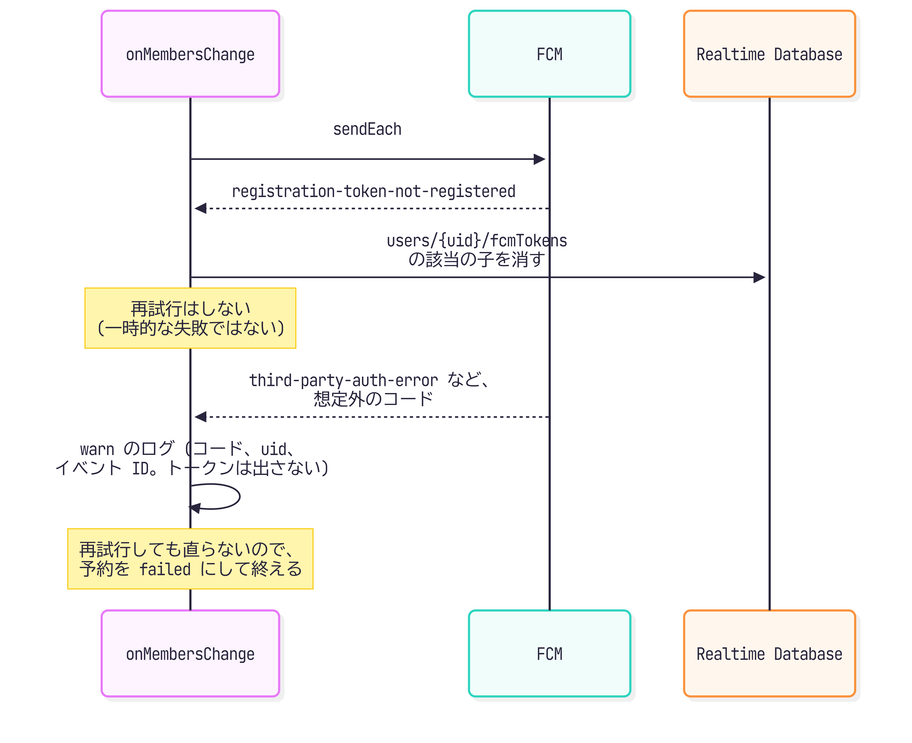

- 無効とみなすのは、`registration-token-not-registered` と `invalid-registration-token` です。
- 消したトークンへは、次回から送りません。
- 想定外のコードは、たとえば、APNs の設定の誤りで返る `third-party-auth-error` です。iOS の受信を確認できない今、設定の誤りに気づくための手がかりとして、警告のログに残します。
- 再試行するエラーの分類は [一部の端末だけ一時的に失敗する](#42-一部の端末だけ一時的に失敗する) を参照してください。

### 4.4 参加と脱退の連打

同じフレンドが、参加と脱退を短い間隔で繰り返したときに、オーナーへ通知を連打しません。（しおり、メンバー、種類）ごとに、3 秒間は、同じ通知を送りません。

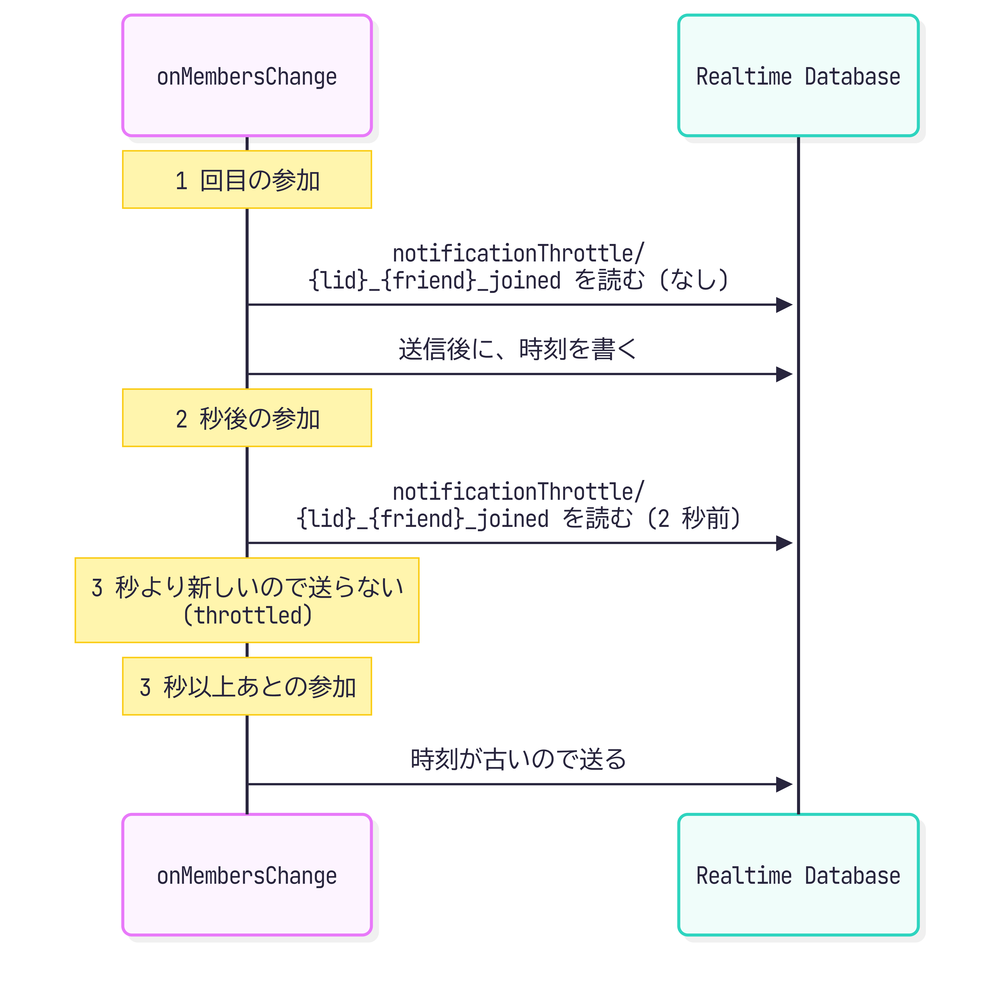

- 3 秒は、人が操作できる速さに合わせた値です。当初は 60 秒でしたが、実機で「抜けてすぐ入り直した」通知が出ず、短くしました。
- 確認と書き込みは不可分ではないので、同時に届いた別のイベントは、両方通りえます。通知が 1 件多いだけで害はないため、厳密にしない割り切りです。
- 抑制の単位に「メンバー」を含めるのは、同じころに参加した 2 人目の通知を、落とさないためです。
- 削除と停止は、オーナーを基準にします（`{lid}_{owner}_deleted` など）。
- Android の通知の置き換え（`tag`）は別の単位です。参加・脱退は（しおり、メンバー）、削除・停止は（しおり、種類）にし、別のメンバーの通知を消さず、同じ通知をまとめます。

### 4.5 古い閉鎖の記録と、古いイベント

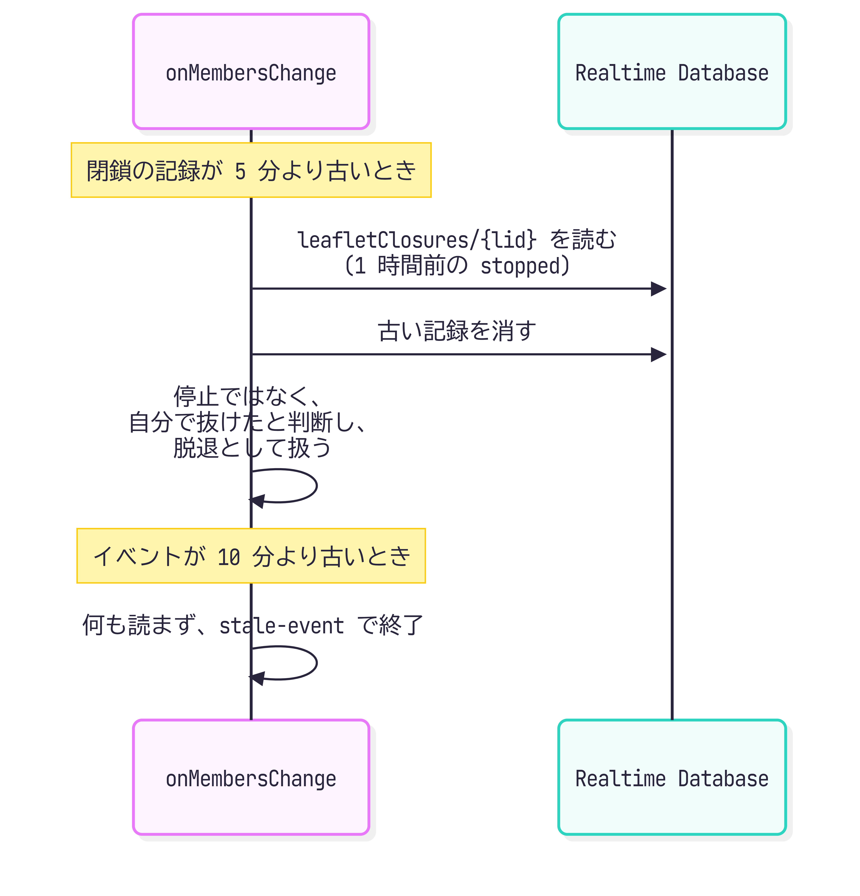

- 古い閉鎖の記録は、たとえば、使われずに残ったものです。これを使うと、あとで自分で抜けた人を、停止された人だと見誤ります。
- 時刻の基準は、記録の `at`（データベースのサーバー時刻）と、イベントの時刻です。

### 4.6 関数が途中で落ちる

予約したあとに、タイムアウトなどで関数が強制終了すると、`pending` の予約だけが残ります。再試行が「予約済み」と判断すると、その通知は二度と送られません。そこで、`pending` のまま 60 秒を過ぎた予約は、取り直せます。

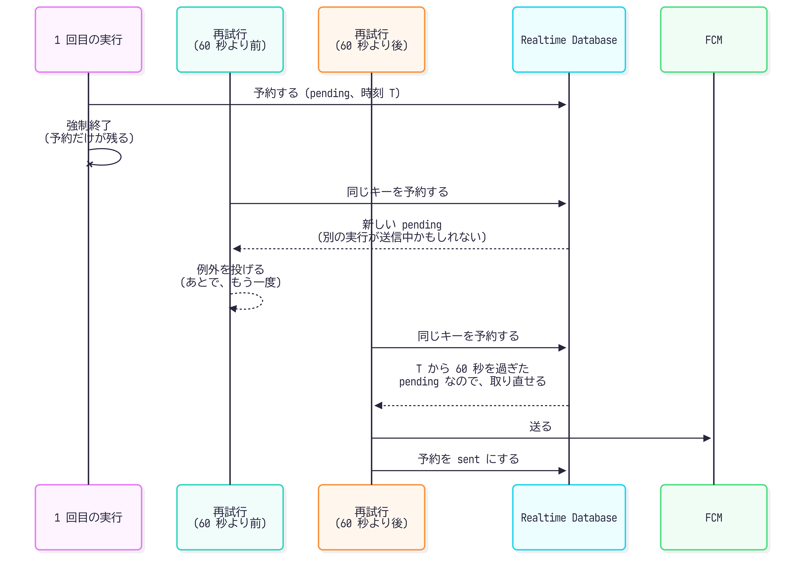

- 「別の実行が送信中」と「落ちて残った予約」は、見た目が同じです。新しい `pending` は、送信中かもしれないので、待ちます（例外で再試行に任せる）。古い `pending` は、落ちたとみなして、取り直します。
- 取り直しの代償として、送信の直後に落ちた場合は、同じ通知が 2 回届きえます。「多くても 1 回」ではなく「少なくとも 1 回」を選んだ、意図した取捨選択です。通知は、1 回も届かないより、まれに 2 回届くほうが害が小さいためです。
- 時間は `PENDING_TTL_MS`（60 秒）です。関数の既定のタイムアウト（`timeoutSeconds` を設定しないと 60 秒。firebase-functions の型定義の説明による）に合わせた値で、実行が生きている間は、取り直されません。タイムアウトを延ばすときは、この値も合わせます。

## 5. データベースの記録の一覧

| パス                                      | 書く人               | 読む人               | 内容             | 寿命                     |
| ----------------------------------------- | -------------------- | -------------------- | ---------------- | ------------------------ |
| `leafletMembers/{lid}/{uid}`              | アプリ               | 関数（契機）、ルール | 契機そのもの     | しおりと同じ             |
| `leafletClosures/{lid}`                   | そのしおりのオーナー | 関数だけ             | 削除と停止の記録 | 関数が使い終えたら消す   |
| `users/{uid}/fcmTokens/{tokenKey}`        | 本人だけ             | 関数だけ             | 宛先の端末       | 無効になったら関数が消す |
| `notificationLog/{eventId}/{tokenKey}`    | 関数だけ             | 関数だけ             | 送信の予約       | 1 日（毎日の掃除が消す） |
| `notificationThrottle/{lid}_{uid}_{kind}` | 関数だけ             | 関数だけ             | 連打の抑制の時刻 | 1 日（毎日の掃除が消す） |

- `leafletMembers` の値は、オーナーが `true`、参加者がハッシュです。
- 閉鎖の記録は `kind`、`title`、`at` を持ちます。5 分より古いものは使いません。
- 端末のトークンは `token`、`at`、`platform` を持ち、キーはトークンのハッシュです。
- 送信の予約は `status`（`pending`、`sent`、`failed`）と `at` を持ちます。

- 関数は、管理者用の SDK で動くので、ルールの対象外です。`notificationLog` と `notificationThrottle` には、ルールを書いていません（クライアントは、読むことも書くこともできません）。
- 閉鎖の記録のルールは、変更前の値（`root`）から、オーナーの uid を確かめます。しおりの削除と同じ更新で書くため、変更後の状態では、オーナーの情報がもう消えているからです。`at` は、書き込み時刻（`now`）と同じ値だけを受け付けます。さらに、オーナーが他のメンバーを消すときは、同じ更新にこの記録があることを、ルールが求めます。ルールのテストに、「削除と同時に書く」「停止と同時に書く」の両方があります（[test/rules.test.js](../../test/rules.test.js)）。

## 6. 実行の設定

リージョンと実行環境は [運用の構成表](../operations/README.md#構成)、契機は [全体像](#1-全体像) を参照してください。通知の関数は `retry: true` にし、古いイベントの打ち切り条件は [4.5](#45-古い閉鎖の記録と古いイベント) で説明しています。

メッセージは `title_loc_key`、`body_loc_key`、`body_loc_args` と、`data`（種類、しおり ID、タイトル、ニックネーム）で構成します。文言の定義場所は次のとおりです。

| 表示先           | 文言の定義                                                                |
| ---------------- | ------------------------------------------------------------------------- |
| Android          | `android/app/src/main/res/values/strings.xml`、`values-ja/strings.xml`    |
| iOS              | `ios/Runner/en.lproj/Localizable.strings`、`ja.lproj/Localizable.strings` |
| アプリ内のバナー | `lib/l10n/app_en.arb`、`app_ja.arb`                                       |

サーバー・Android・iOS・ARB のキーと引数の数は、[check_l10n.py](../../tool/ci/check_l10n.py) がそろっていることを検査します。

- リテラルの title と body を入れない理由：Android の FCM クライアントは、title と body があると、文言のキーより先にそれを使います。英語の文を入れていたときは、日本語の端末でも、英語の通知が出ました（実機で確認）。文言のキーだけを送ると、端末の言語の文言になります（[FCM のメッセージの項目](https://firebase.google.com/docs/reference/fcm/rest/v1/projects.messages)）。
- ニックネームとしおりのタイトルは、クライアントが書いた値なので、サーバーが無害化します（制御文字と向きを変える文字は空白に、ゼロ幅の文字は取り除く。ニックネームは 20 文字、タイトルは 100 文字まで。ZWJ は絵文字の連結に要るので残す）。
- 数人規模を前提にしています。宛先の読み込みは逐次で、`sendEach` は 1 回 500 件までです。大規模にするときは、読み込みの並列化、500 件ごとの分割、送信のキュー（Cloud Tasks など）を検討します。
- 前面でアプリが開いているときは、OS は通知を出しません。アプリが、`data` から、同じ文言でバナーを出します。
- 通知と掃除のデプロイ、Cloud Scheduler の作成・停止は [Firebase の運用](../operations/README.md#通知の関数cloud-functions) に集約しています。

## 7. テストと読む順番

`npm run test:functions` で、Realtime Database の Emulator を使って実行します。FCM への送信と Authentication は差し替えます。

| ファイル         | 確かめること                             |
| ---------------- | ---------------------------------------- |
| decide.test.ts   | 差分と閉鎖の記録からの、通知の種類の判定 |
| handler.test.ts  | 送信の流れと、品質のためのユースケース   |
| nickname.test.ts | 名前とタイトルの無害化                   |
| payload.test.ts  | 送るメッセージの組み立て                 |
| cleanup.test.ts  | 掃除の対象の選別と、安全のための中止     |
| index.test.ts    | 契機、再試行、スケジュール、リージョン   |

- `decide.test.ts`：メンバーの差分、オーナー、閉鎖の記録の鮮度から、参加・脱退・削除・停止を判定する。
- `handler.test.ts`：宛先、新旧のトークン、二重防止、予約の取り直し、部分的な失敗、再試行、警告、連打、古いイベント、閉鎖の記録の消去、タイトルの無害化。
- `nickname.test.ts`：制御文字、ゼロ幅の文字、長さ、絵文字の連結。
- `payload.test.ts`：文言のキーと引数、Android の `tag`、iOS の項目、リテラルの title と body を送らないこと。
- `cleanup.test.ts`：確認だけの実行、トークンを先に消す順序、古い通知の記録、Authentication への問い合わせの失敗時の中止と、100 件ずつの照会。
- `index.test.ts`：関数の設定（契機のパス、`retry`、毎日 4:00 の日本時間、リージョン）が、この文書のとおりであること。

「誰に、何を送ろうとしたか」を確かめるため、送信は、メッセージの一覧を記録する偽物に差し替えています。

読む順番は、次をお勧めします。

1. この文書の 1 章と 2 章（全体像と共通の流れ）
2. [decide.ts](../../functions/src/decide.ts) と [decide.test.ts](../../functions/test/decide.test.ts)（純粋関数で、いちばん読みやすい）
3. [handler.ts](../../functions/src/handler.ts) の `handleMembersChange` と `deliver`
4. [payload.ts](../../functions/src/payload.ts)
5. [handler.test.ts](../../functions/test/handler.test.ts)（4 章のユースケースが、テストになっている）
